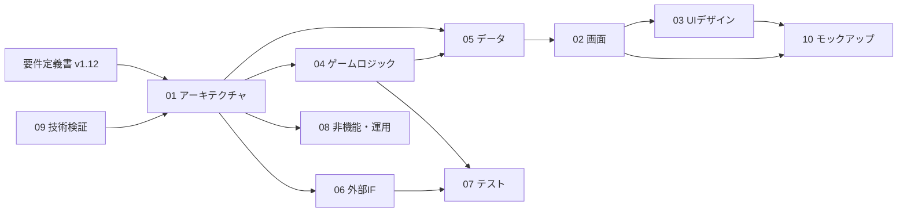

# 00 基本設計 目次と要件への反映事項

> 版：1.0（2026-10-31） ／ 対象要件：`requirements_v1.12.md`
> 目的：基本設計の資料の全体像と、レビューのしかた、要件書に反映すべき変更点をまとめる。

---

## 1. 資料の一覧

| # | 資料 | 目的 |
|---|---|---|
| 01 | `01_architecture.md` アーキテクチャ設計書 | システム構成、技術スタック、フォルダ構成、層の依存ルール、ビルドとデプロイ |
| 02 | `02_screen_design.md` 画面設計書 | 画面一覧と遷移、画面ごとの要素・状態・操作、スマホと PC の差 |
| 03 | `03_ui_design_spec.md` UIデザイン仕様 | 色（コントラスト確認つき）、文字、余白、部品、動き、アクセシビリティ |
| 04 | `04_game_logic.md` ゲームロジック設計書 | 状態遷移、step 関数、1ターンの処理、ドロー、連鎖、切り札、判定、乱数、境界条件 |
| 05 | `05_data_design.md` データ設計書 | ID の命名、カード JSON とその検証、マスターデータ、SaveData、途中データ |
| 06 | `06_external_interface.md` 外部インターフェース設計書 | ストレージ、GA4（同意・イベント）、X へのシェア（文字数）、画像生成、結末ページと OGP |
| 07 | `07_test_design.md` 検証・テスト設計書 | 単体テスト、シミュレータ（Bot・合格基準）、E2E、手動確認、CI |
| 08 | `08_nonfunctional_ops.md` 非機能・運用設計書 | 性能の予算、素材の作り方、対応環境、エラー処理、セキュリティ、公開と運用、法的表記 |
| 09 | `09_tech_spike.md` 技術検証メモ | Cloudflare Pages のルーティング、日本語フォント、html-to-image を実際に試した結果 |
| 10 | `10_mockup.md` 静的モックアップ | デザインキャンバスへのリンクと、確認してほしい点 |
| 11 | `11_platform_integration.md` 公開統合設計書 | PromptLab Games の共通ドメイン配下への公開（Router・Portal・URL・検証）。**01・02・06・08 と食い違う場合は 11 を正とする**（2026-11-01 追加） |

### 資料どうしの関係

---

## 2. レビューのしかた（おすすめの読む順）

1. **10 モックアップ**（見た目で全体をつかむ）→ **02 画面** → **03 UIデザイン**
2. **04 ゲームロジック** → **05 データ**（ルールが要件どおりか。04 の 11章の境界条件が、意図どおりの答えになっているか）
3. **06 外部IF**（特に、シェア文の長さの調整ルールと、EEA 向けの同意の扱い）
4. **07 テスト**（シミュレータの Bot と合格基準が、目指す難しさを表しているか）
5. **01 アーキテクチャ**、**08 非機能・運用**、**09 技術検証**

- 外部のAIにレビューを頼む場合は、残っていた観点 7〜10（技術・UX・性能・工数）を、この資料一式に対して見てもらうのが効果的（`docs/review_perspectives.md`）。

---

## 3. 要件書に反映すべき変更点（v1.13 の候補）

基本設計の中で、要件書と違う決定をした点、または要件書を補った点。レビューで合意できたら、要件書 v1.13 にまとめて反映する。

### 3.1 要件を変更するもの

| # | 要件の箇所 | 要件書の記述 | 基本設計での決定 | 理由 | 出典 |
|---|---|---|---|---|---|
| R1 | 4.1 フォント | JetBrains Mono、Fira Code、ui-monospace | **M PLUS 1 Code**（サブセット化してセルフホスト） | 要件のフォントには日本語の字形がない | 01 D6、09 検証2 |
| R2 | 7.3-1 | `_redirects` に `/* /index.html 200` | **置かない**（`404.html` も置かない） | Cloudflare Pages の既定の動きで足りる | 01 D5、09 検証1 |
| R3 | 7.3-2 | `/assets/*.webp` を immutable | `/assets/*` 全体を immutable、`/ogp/*` は1日 | 画像をハッシュ付きの名前で配信するため | 01 7.3 |
| R4 | 4.2、7.3-4 | 起動時に17枚を一括プリロード | 起動時はアイコン8枚、一枚絵9枚は最初のカードの後に裏で読む | スマホでの最初の表示を速くするため | 08 1.3 |
| R5 | 7.4-4 イベント名 | `play_duration_seconds`、`drop_at_week_X`、`retry_click_count` | `play_duration`、`drop_at_week`（週はパラメータ）、`retry_click` | GA4 の集計のしやすさ | 06 2.2 |
| R6 | 3.4-3 シェア定型文 | 定型文のまま | 280文字（全角は2文字として数える）を超えたら、4段階で短くする | 会社名が長いと上限を超える（試算で294文字） | 06 3.2 |
| R7 | 3.4-2 Web Share | 画像とテキストを渡す | 画像だけを渡し、本文はクリップボードにコピーしておく | 共有先によってテキストが消えたり、二重になったりする | 06 3.3 |
| R8 | 3.2 連鎖 | 予約済みの連鎖カードは重複予約しない | **1ランに1回まで**（表示済みも対象） | 同じツケが2回来ると印象が薄れる | 04 6.3 |
| R9 | 2. 技術スタック | framer-motion、TypeScript | motion（framer-motion の現在の名前）、TypeScript 6.0 系 | 同じライブラリの正式名。typescript-eslint が TS 7 に未対応 | 01 D1、D2 |
| R10 | 3.1-6 テンポ | アニメーション・トランジションは0.3秒以下 | 倒産の演出（0.6秒）だけは例外とする | ラン終了の「間」を作るため。プレイ中の選択のテンポには影響しない | 03 6章 |
| R11 | 3.2 カード数、6章 ロードマップ | MVP は77枚（共通50＋スタイル別15＋連鎖6＋季節4＋導入2）。遅れたらスタイル別を延期 | **Phase 1（MVP）は62枚**（共通50＋連鎖6＋季節4＋導入2）。スタイル別15枚は最初から Phase 2（Week 5）の作業にする | 工数の試算（58〜82時間）が上限を超えるため。未読カードの優先ドローで、62枚でもリプレイ性は保てる | review_bd_r4 |
| R12 | 1・2・7.3 公開先 | `genkai-ses.pages.dev` に直接公開 | `https://promptlab-games.com/genkai-ses/`（ブランド共通の Router 経由）。本番ブランチ `develop`、Node 24 | ブランド「PromptLab Games」の新規タイトルとして公開するため | 11 |
| R13 | 3.4 結末ページ | `/results/{id}/index.html`、URL は末尾スラッシュ付き | `results/{slug}.html`、URL は末尾スラッシュなし | Router 経由では Pages の相対リダイレクトで公開パスが抜けるため | 09 検証4、11 2.1 |
| R14 | 1・3.3・3.5・3.6 表現 | Web 版は露骨な違法用語も使う | Web 版も言い換えた表現に一本化 | 同じドメインでブランドが AdSense の審査を受けているため | 要件 v1.13 3.6-8 |
| R15 | 7.2・7.4 規約 | ゲーム内に独自の規約・プライバシーポリシー・問い合わせ | ブランド共通のページにリンク。ブランドのプライバシーポリシーに本作の計測を追記 | ブランドの統一と工数削減 | 11 3章 |
| R16 | 4.2 素材 | 話者アイコン8枚、32×32 で描いて4倍 | **9枚（秘書を追加）、64×64 で描いて2倍**（画面上は同じ 128px）。生成は ChatGPT に統一 | 32×32 では表情がつぶれた（比較画像で確認）。導入カードの話者のアイコンがなかった | 08 2.1、`docs/assets/asset_prompts_v2.md` |

### 3.2 要件を補うもの（未定義だった点を決めたもの）

| # | 要件の箇所 | 決めたこと | 出典 |
|---|---|---|---|
| A1 | 7.2-5 | GA4 の同意：タイムゾーンで EEA などと推定したときだけ同意バナーを出す | 06 2.1 |
| A2 | 3.2 型 | `RuntimeGameState` に `rngState`、`shownChainCardIds` を追加 | 04 10章 |
| A3 | 3.2 型 | `EventCard` に `tutorial_week` を追加。`speaker_icon` をファイル名から ID に | 05 7章 |
| A4 | 3.5 型 | `SaveData` の `first_played_at` / `last_played_at` を null 許容に | 05 5.1 |
| A5 | 3.5 型 | `SessionSnapshot` に `content_hash` を追加。対象はカードの構造だけ（ID・種類・連鎖のつながりなど）で、文言や数値の修正では途中データを消さない | 05 6章 |
| A6 | 3.2 連鎖 | 連鎖の予約は、初回プレイの Week 1〜2（導入カードの週）も避ける | 04 6.3 |
| A7 | 7.5-4 | 称号（スピード退職・監査局の常連）の取得率の下限を 0.5% に | 07 3.4 |
| A8 | 7.5-3 | Bot の詳しい動き（`random` の切り札は毎ターン3%、`greedy` の切り札の条件など）。称号の判定用に、目標値をずらした `greedy:white`・`greedy:bicycle` を追加し、A6 は称号ごとに判定する Bot を分ける | 07 3.2、3.4 |
| A9 | 3.2 / 05 | カードの文字数の上限（本文100、選択肢20、話者名16、敗因30） | 02 6章、05 3.3 |
| A10 | 7.2 | CSP などのセキュリティヘッダー | 08 5.1 |
| A11 | 7.4-1 | お問い合わせは Google フォーム（入力は内容と任意の返信先だけ） | 08 7章 |
| A12 | 4.2 | 素材はロスレス WebP。アイコンは 64×64 で2倍（R16）、一枚絵は 320×180 で4倍に拡大 | 08 2.1 |
| A13 | 3.2 型 | 連鎖の予約の入力をそろえる `InjectionParam` を追加。敗因の文言（`PendingInjection.regretText` など）の型を `Text`（web / store）に | 04 6.3、10章 |
| A14 | 7.4-4 計測 | Cloudflare Web Analytics は、JS スニペットを手動で埋め込む（`index.html` と結末ページ）。トークンは環境変数で渡す | 06 2.3 |
| A15 | 3.4-2 シェア | 結果画像は、リザルト画面を表示した時点で裏で作っておく。シェア・コピー・保存のボタンは作成済みの画像を使い、押した処理の中で `await` をはさまない（iOS Safari の操作の期限切れ対策） | 06 3.3、3.4、4章 |

---

## 4. 次の工程

- 3章の R1〜R15・A1〜A15 は、要件書 **v1.13（2026-11-01）に反映済み**。R16 は **v1.14（2026-11-11）に反映済み**。型の追加項目などの細部は、各設計書を正とする。

1. 基本設計のレビュー（オーナー、必要に応じて外部AI）。指摘を反映する。
2. 要件書 v1.13 に、3章の変更点を反映する。
3. **実装のフェーズ分け**（作業の分解、各フェーズの完了条件、遅れたときに削る順番）を別の資料にまとめる。
