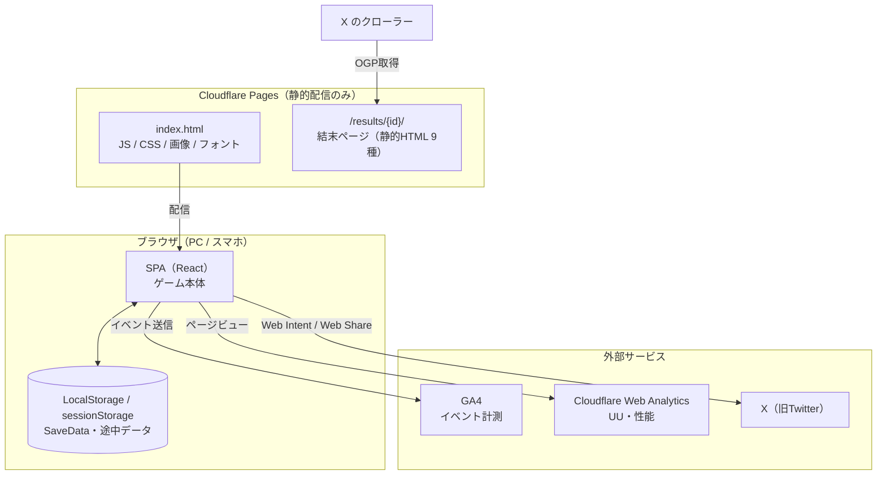
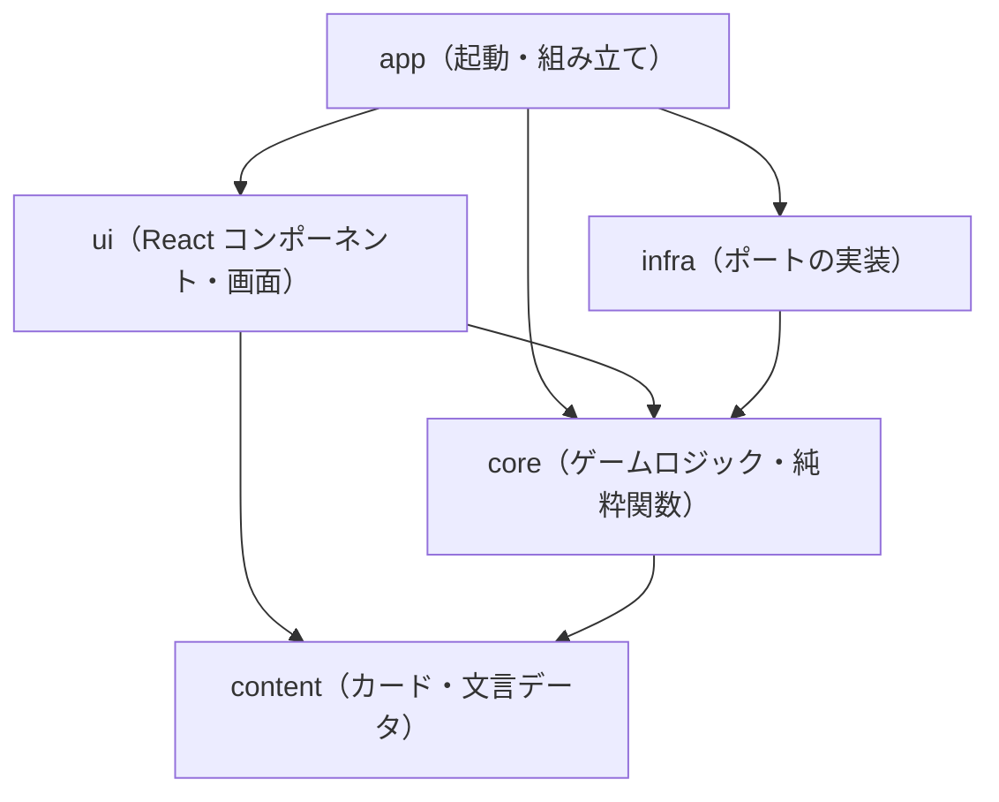

# 01 アーキテクチャ設計書

> 版：1.0（2026-10-31） ／ 対象要件：`requirements_v1.12.md` ／ 関連：`09_tech_spike.md`
> 目的：システム全体の骨格（構成、技術、フォルダ、依存ルール、ビルドとデプロイ）を決め、以降の設計書と実装の前提にする。

---

## 1. 前提と設計方針

| # | 方針 | 根拠（要件） |
|---|---|---|
| P1 | **サーバーを持たない。** 静的ファイルの配信だけで完結し、データはブラウザ内（LocalStorage / sessionStorage）に置く | 2. 技術前提 |
| P2 | **ゲームロジックは純粋関数にする。** DOM、React、ストレージ、時刻、乱数に直接触れない | 2. アーキテクチャ方針、7.5 シミュレータ |
| P3 | **外部とのやりとりはすべてインターフェース（ポート）越しにする。** ストレージ、計測、シェア、画像生成、乱数、時刻 | 2.（アプリ化への移植）、09 検証3（画像生成の代替案） |
| P4 | **コンテンツ（カード・文言）はデータとしてコードから分け、ビルド時に検証する** | 3.2、3.6、7.5-2 |
| P5 | **依存ライブラリは最小限にする。** ルーター、状態管理ライブラリ、UI キットは使わない | 2. 工数（40〜60時間） |

---

## 2. システム構成



- サーバー側の処理（Pages Functions、KV など）は**使わない**。結末ページは、ビルド時に静的 HTML として生成する（09 検証1）。
- 外部への送信先は GA4 と Cloudflare Web Analytics だけ（Web版PoCでは広告なし。要件 5.1）。

---

## 3. 技術スタック

| 区分 | 採用 | バージョン（2026-10-31 時点） | 備考 |
|---|---|---|---|
| 言語 | TypeScript | **6.0.x** | 最新は 7.x だが、typescript-eslint が `<6.1` までしか対応していないため 6.0 系にする |
| UI | React / React DOM | 19.x | 要件の「v18 以降」を満たす |
| ビルド | Vite ＋ @vitejs/plugin-react | 8.x ／ 6.x | |
| スタイル | Tailwind CSS（@tailwindcss/vite） | 4.x | 設定は CSS の `@theme` で行う |
| アニメーション | **motion**（旧 framer-motion） | 14.x | framer-motion と同じライブラリで、現在の正式な名前。`motion/react` から import する |
| アイコン | lucide-react | 1.x | 使うアイコンだけを個別に import する |
| 画像生成 | html-to-image | 1.11.x | `ResultImageRenderer` の実装の1つ（09 検証3） |
| フォント | M PLUS 1 Code（@fontsource）＋ subset-font | 5.x ／ 2.x | ビルド時に使う文字だけに絞り込む（09 検証2）。Node だけで動くので、Python は不要 |
| データ検証 | zod | 4.x | カード JSON のスキーマ検証と、SaveData の読み込み時の検証 |
| 単体テスト | Vitest | 5.x | ゲームロジック中心 |
| 画面テスト | @playwright/test | 1.64.x | 主要な流れの動作確認（Chromium） |
| CLI 実行 | tsx | 4.x | シミュレータとビルドスクリプトの実行 |
| ローカル配信 | wrangler（`pages dev`） | 4.x | 本番と同じルーティングでの確認 |
| 静的解析 | ESLint ＋ typescript-eslint ＋ dependency-cruiser | 10.x ／ 8.x ／ 18.x | 層の依存ルール（4章）を機械的に検査する |

- バージョンはメジャーを固定する（`^`）。`package-lock.json` をリポジトリに含める。
- **実装の着手時に、上の表のバージョンを npm で再確認する。** その時点で周辺ツールとの非互換が見つかった場合（例：typescript-eslint が対応していない）は、1つ前の安定したメジャー版に固定し、本表と 8章の決定事項を更新する（基本設計レビュー第3回の指摘4）。表の値は 2026-10-31 に npm で確認した安定版である（zod 4 も正式版）。
- Node.js は 22 LTS を使う（Cloudflare Pages のビルド環境の環境変数 `NODE_VERSION=22` で指定する）。

---

## 4. 層の構成と依存ルール



| 層 | 役割 | 依存してよい先 | してはいけないこと |
|---|---|---|---|
| `core` | 状態遷移、ドロー、効果の計算、死亡判定、称号判定、売上の計算。**ポートの型（インターフェース）もここで定義する** | `content` の型とデータのみ | DOM、React、`window`、`localStorage`、`Date.now()`、`Math.random()` を直接使う |
| `content` | カード JSON、スタイル・結末・称号の定義、UI 文言辞書、NG 社名リスト | なし | ロジックを持つ |
| `infra` | ポートの実装（ストレージ、GA4、シェア、画像生成、乱数、時刻） | `core`（ポートの型） | `ui` に依存する |
| `ui` | 画面とコンポーネント。`core` の状態を表示し、操作を `core` に渡す | `core`、`content` | `infra` を直接 import する（ポート経由で受け取る） |
| `app` | 起動処理。ポートの実装を組み立てて `ui` に渡す（依存性の注入） | すべて | ゲームのルールを持つ |

- このルールは dependency-cruiser で CI 時に検査する（違反したらビルドを失敗させる）。
- シミュレータ（`tools/simulate`）は `core` と `content` だけを使う。そのため、UI もブラウザもない状態で実行できる。

### 4.1 ポート（`core/ports.ts` で定義）

| ポート | 役割 | Web版の実装 | 備考 |
|---|---|---|---|
| `SaveRepository` | SaveData の読み書き | LocalStorage（失敗時はメモリに保持） | 要件 7.2-4。アプリ化時は AsyncStorage などに差し替える |
| `SessionRepository` | 途中データの退避と復元 | sessionStorage（失敗時はメモリに保持） | 要件 7.2-3 |
| `AnalyticsPort` | イベント送信 | GA4（gtag）。送信できないときは何もしない | 要件 7.4-4。同意の扱いは 06 で決める |
| `ShareService` | X へのポスト、画像付きシェア、コピー、保存 | Web Intent ／ Web Share API ／ Clipboard API | 要件 3.4 |
| `ResultImageRenderer` | 結果画像の生成 | html-to-image（代替：Canvas 2D） | 09 検証3 |
| `Random` | 乱数 | シード付きの疑似乱数（例：mulberry32） | テストとシミュレータで結果を再現するため |
| `Clock` | 現在時刻 | `Date` | プレイ時間、D1 / D7 の計算 |

---

## 5. フォルダ構成

```
genkai-ses/
├─ docs/                      要件定義書・設計書・レビュー記録
├─ public/
│  ├─ _headers                キャッシュ設定（7章）
│  ├─ ogp/                    OGP 画像（end_{id}.png。ファイル名は固定）
│  └─ favicon.svg
├─ src/
│  ├─ app/                    起動、ポートの組み立て
│  ├─ core/                   ゲームロジック（純粋関数）とポートの型
│  │  ├─ ports.ts
│  │  ├─ state.ts             RuntimeGameState、初期化
│  │  ├─ turn.ts              1ターンの処理（要件 3.1-6 の処理順）
│  │  ├─ deck.ts              山札の構築とドロー
│  │  ├─ effects.ts           倍率、丸め、クランプ
│  │  ├─ judge.ts             死亡判定、敗因、称号、売上
│  │  └─ rng.ts               シード付き乱数
│  ├─ content/
│  │  ├─ cards/*.json         カードデータ（種類ごとにファイルを分ける）
│  │  ├─ schema.ts            zod スキーマ（JSON の検証と型の生成）
│  │  ├─ styles.ts / endings.ts / achievements.ts
│  │  ├─ strings.ts           UI 文言辞書（web / store）
│  │  └─ ng_company_names.ts  NG 社名リスト
│  ├─ infra/                  ポートの実装
│  ├─ ui/
│  │  ├─ screens/             画面単位のコンポーネント
│  │  ├─ components/          カード、ゲージ、ボタンなどの部品
│  │  └─ hooks/
│  ├─ assets/                 話者アイコン、結末画像（Vite が名前にハッシュを付ける）
│  └─ styles/                 Tailwind の設定（@theme）、フォント定義
├─ tools/
│  ├─ simulate/               ヘッドレスシミュレータ（npm run simulate）
│  ├─ validate-cards.ts       カード JSON の検証
│  ├─ subset-font.ts          フォントのサブセット化
│  └─ gen-result-pages.ts     結末ページ（静的HTML）の生成
├─ tests/
│  ├─ unit/                   Vitest
│  └─ e2e/                    Playwright
└─ package.json
```

---

## 6. アプリ内の状態管理と画面の切り替え

- **状態管理：** `core` が `step(state, action, deps) → { state, events }` 形式の関数を提供する。
  - UI は React の `useReducer` でこの関数を使う。状態管理ライブラリは使わない。
  - `events`（カード表示、ゲームオーバー、クリア、切り札の発動など）は、`app` 層のハンドラが受け取り、計測、途中データの退避、SaveData の更新へ振り分ける。この仕組みにより、`core` は副作用を持たない。
- **画面の切り替え：** ルーターライブラリは使わない。画面は状態として持つ。
  - 画面の状態：`title` / `companyName` / `styleSelect` / `play` / `result`
  - モーダル（図鑑・遊び方・規約）は、画面の上に重ねて表示する。
  - URL は常に `/` のままにする。起動時に `location.pathname` が `/results/...` だった場合（SPA に届いた、存在しない結末の URL）は、`/` に置き換えてタイトル画面を表示する。
- **ブラウザの「戻る」：** プレイ中に「戻る」でページを離れても、途中データから再開できるので許容する（要件 7.2-3）。`history` の操作はしない。

---

## 7. ビルドとデプロイ

### 7.1 npm スクリプト

| スクリプト | 内容 |
|---|---|
| `dev` | Vite の開発サーバー |
| `validate:cards` | カード JSON の検証（スキーマ、参照、`unethical` の連鎖、ID の重複など。要件 7.5-2） |
| `simulate` | シミュレータ（オプションでシード、Bot、ラン数を指定する。合格基準を満たさなければ終了コード 1） |
| `build` | 次の順に実行する：`validate:cards` → `subset-font` → `tsc --noEmit` → `vite build` → `gen-result-pages` |
| `preview` | `wrangler pages dev dist`（本番と同じルーティングで確認する） |
| `test` / `test:e2e` | Vitest ／ Playwright |
| `lint` | ESLint ＋ dependency-cruiser |

### 7.2 デプロイ
- Cloudflare Pages の **Git 連携**（GitHub）を使う。
  - `main` ブランチへの push で本番に反映する。それ以外のブランチはプレビュー環境（固有の URL）になる。
  - ビルドコマンドは `npm run build`、出力先は `dist`、環境変数は `NODE_VERSION=22`。
- 環境変数（ビルド時に埋め込む）：
  - `VITE_GA_MEASUREMENT_ID`：GA4 の測定 ID。未設定なら計測しない（プレビュー環境では未設定にする）。
  - `VITE_APP_STORE_SAFE_MODE`：Web版は `false`。
  - `VITE_SITE_ORIGIN`：OGP の絶対 URL を作るときに使う（例：`https://genkai-ses.pages.dev`）。
  - `VITE_CF_BEACON_TOKEN`：Cloudflare Web Analytics のトークン。`index.html` と結末ページに埋め込む（06 の 2.3）。未設定なら埋め込まない。
- **CI（GitHub Actions）：** プルリクエストごとに `lint`、`test`、`validate:cards`、`simulate`（ラン数を減らした高速版）を実行する。シミュレータの合格基準から外れた場合は、警告として出す（ビルドは止めない）。

### 7.3 配信の設定（09 検証1の結論を反映）
- `_redirects` は置かない。`404.html` も置かない（SPA フォールバックが止まるため）。
- `public/_headers` の内容：

| パス | Cache-Control | 理由 |
|---|---|---|
| `/assets/*` | `public, max-age=31536000, immutable` | Vite がファイル名にハッシュを付けるので、中身が変わればファイル名も変わる |
| `/ogp/*` | `public, max-age=86400` | X が参照するため、ファイル名を固定している（仮素材から差し替える可能性がある） |
| `/results/*`、`/` | （既定のまま） | HTML はキャッシュしない |

- **要件 7.3-2 からの変更：** 要件は `/assets/*.webp` を immutable としている。これを、Vite がハッシュを付けた `/assets/*` 全体に広げる。画像は `src/assets` から import するので、差し替えれば URL も変わり、古いキャッシュが残る問題は起きない。

---

## 8. 決定事項の記録

| # | 決定 | 理由 | 代わりに検討したもの |
|---|---|---|---|
| D1 | TypeScript 6.0 系 | typescript-eslint が 7 系に未対応 | TS 7（型チェックは速いが、lint が動かない） |
| D2 | motion（旧 framer-motion） | 同じライブラリの現在の名前で、今後の更新はこちらに入る | framer-motion（互換のために残っている名前） |
| D3 | ルーターを使わない | 画面は5つで、URL を共有する必要がない（結末ページは静的 HTML） | React Router |
| D4 | 状態管理ライブラリを使わない | `core` の純粋関数と `useReducer` で足りる。シミュレータと同じ関数を使える | Zustand、Redux |
| D5 | `_redirects` と `404.html` を置かない | Cloudflare Pages の既定の SPA フォールバックで足りる（09 検証1） | 要件 7.3-1 の `_redirects` |
| D6 | フォントは M PLUS 1 Code のみ（ビルド時にサブセット化） | 日本語と英数字の両方が等幅。容量は約150〜200KB（09 検証2） | JetBrains Mono と日本語フォントの併用 |
| D7 | 画像生成をポートの裏に隠す | iOS Safari で html-to-image が動かない場合に Canvas 2D へ切り替えるため（09 検証3） | html-to-image を直接呼ぶ |
| D8 | 画像は `src/assets` から import（ハッシュ付き）、OGP 画像だけ `public/ogp`（名前固定） | 長期キャッシュと差し替えの両立 | すべて `public` に置く |

---

## 9. 他の設計書に引き継ぐ事項

| 事項 | 引き継ぎ先 |
|---|---|
| `step` 関数の action と events の一覧、各関数の入出力 | 04 ゲームロジック設計書 |
| zod スキーマの詳細、ID の命名ルール、SaveData の移行方法 | 05 データ設計書 |
| GA4 の同意の扱い（EEA 向け）、イベントの送信タイミング | 06 外部インターフェース設計書 |
| 性能の目標値（JS の容量、初回表示の時間）と計測方法 | 08 非機能・運用設計書 |
| 結末ページと OGP 画像（end_*.webp から 1200×630 の PNG を作る方法） | 06 ／ 08 |
