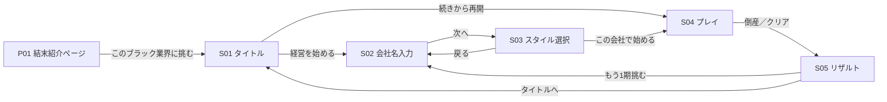

# 02 画面設計書

> 版：1.0（2026-10-31） ／ 対象要件：`requirements_v1.12.md`（4.1、3.4、3.5、7.2、7.4） ／ 関連：`03_ui_design_spec.md`、`04_game_logic.md`、`10_mockup`（デザインキャンバス）
> 目的：何をどの画面に表示し、どう操作するかを決める。見た目の細部（色・文字・余白）は 03、実際の見た目は 10 のモックアップで確認する。

---

## 1. 画面一覧

| ID | 画面 | 種類 | 主な目的 |
|---|---|---|---|
| S01 | タイトル | 画面 | ゲームの入口。開始、再開、図鑑、規約への導線 |
| S02 | 会社名入力 | 画面 | 会社名を決める（NG 判定つき） |
| S03 | 経営スタイル選択 | 画面 | 3つのスタイルから1つ選ぶ |
| S04 | プレイ | 画面 | 2択を繰り返す本編 |
| S05 | リザルト | 画面 | 倒産報告書（またはクリアの決算通知書）とシェア |
| M01 | 図鑑 | モーダル | 結末9種・称号6種・最高記録 |
| M02 | 遊び方 | モーダル | ルールと操作の説明 |
| M03 | 規約・プライバシー・免責 | モーダル | 法的表記（要件 7.4-1） |
| M04 | お問い合わせ | モーダル | 連絡先（外部フォームへのリンク。連絡手段は 08 で決める） |
| P01 | 結末紹介ページ | 静的ページ | `/results/{slug}/`。OGP と、訪れた人をゲームに誘導する（要件 3.4） |

---

## 2. 画面遷移

- モーダル（M01〜M04）は、S01 から開く。M01（図鑑）は S05 からも開ける。
- **S04 の途中で離れた場合：** 途中データは毎ターン退避しているので、再読み込みすると S01 に「続きから再開」が出る（要件 7.2-3）。S04 に「タイトルへ戻る」ボタンは置かない（誤操作でランを失わないため）。
- **ブラウザの「戻る」：** 履歴は操作しない（01 の 6章）。S04 で「戻る」を押すとページを離れるが、途中データから再開できる。
- 「もう1期挑む」で S02 に戻るとき、会社名は前回の入力を入れた状態にする（Enter だけで進めるようにして、リトライまでの手間を減らす）。

---

## 3. レイアウトの基本

| 区分 | スマホ（幅 768px 未満） | PC・タブレット（幅 768px 以上） |
|---|---|---|
| ゲーム領域 | 画面幅いっぱい（左右 16px の余白） | 幅 480px で中央に置く。左右は `bg` の余白 |
| 高さ | 画面の高さに合わせる（`100dvh`）。S04 はページ全体をスクロールさせない。収まらないときの動きは 6.2 | 同左 |
| キー操作のヒント | 表示しない | S04 の決断ボタンの下に「← / → で選択、Space で切り札」を表示する |
| S05 リザルト | 1列（報告書 → シェア → 次の行動） | 2列（左：報告書、右：シェアと次の行動）。幅 960px で中央に置く |

- 基準の画面サイズ：スマホは 390×844（iPhone 14 など）、最小 360×640 で崩れないこと。PC は 1280×800。

---

## 4. 操作の割り当て

| 操作 | キーボード | タッチ | マウス |
|---|---|---|---|
| 左の選択肢を選ぶ | `←` | カードを左へスワイプ、または左の決断ボタンをタップ | カードを左へドラッグ、または左の決断ボタンをクリック |
| 右の選択肢を選ぶ | `→` | 右へスワイプ、または右のボタン | 右へドラッグ、または右のボタン |
| 選択肢の予兆を見る | （なし。ボタンにフォーカスすると表示） | カードを傾けている間 | カードを傾けている間、または決断ボタンにホバー |
| 切り札（1回目：確認） | `Space` | 切り札ボタンをタップ | 切り札ボタンをクリック |
| 切り札（2回目：発動） | 確認状態で `Space` | 確認状態のボタンをもう一度タップ | もう一度クリック |
| 切り札の取り消し | `Esc`、または `←` `→`（そのまま選択になる） | ボタン以外をタップ、カードのドラッグ開始、決断ボタン | 同左 |
| モーダルを閉じる | `Esc` | × ボタン、幕をタップ | 同左 |

- 切り札の操作の詳細は、要件 3.1-4（v1.10）のとおり。
- キーの操作は S04 でだけ有効にする（入力欄に文字を入れている間は無効）。
- スワイプの決定のしきい値は、横方向に 80px、または素早く払う操作（03 の 6章）。カードの上では `touch-action: none` を指定し、ドラッグがページのスクロールと競合しないようにする。S04 は画面全体をスクロールさせない設計なので、ほかの場所でも縦スクロールは起きない。画面の端から始まるブラウザの「戻る」ジェスチャーと重ならないよう、カードは画面の左右の端から 16px 以上離して置く。

---

## 5. 画面ごとの仕様

### S01 タイトル
| 要素 | 内容 |
|---|---|
| ゲーム名 | 「限界SES社長」（`display`）と副題「〜人月ピラミッドの頂点へ〜」 |
| キャッチコピー | 「今期も、誰もバックれませんように。」 |
| 主ボタン | ［経営を始める］ |
| 続きから再開 | 途中データがあるときだけ表示（副ボタン）。「第12週から再開」のように週を添える |
| 副ボタン | ［図鑑］（M01） |
| 効果音 | 右上のアイコンボタンで ON / OFF（初期値 OFF。要件 7.1-2） |
| フッター | 文字リンク：遊び方（M02）、規約・プライバシー・免責（M03）、お問い合わせ（M04） |
| 免責文 | フッターの上に常設（要件 1.「フィクション免責事項」） |

### S02 会社名入力
| 要素 | 内容 |
|---|---|
| 見出し | 「あなたの会社名を決めてください」 |
| 入力欄 | 最大15文字。前回の会社名を初期値に入れる。空のまま進むと「限界SES株式会社」 |
| 注記 | 「実在の企業名は使えません。会社名は架空のものとして結果画像に印字されます。」 |
| エラー表示 | 入力欄の下に `danger-text` で表示する。①NG 社名に一致：「実在の企業名は使えません」②`@` `#` URL を含む：「記号（@ # ）や URL は使えません」③16文字以上：入力自体をさせない（`maxlength`） |
| ボタン | ［次へ］（主）。Enter キーでも進む |

- 判定は［次へ］を押したときに行う（入力中に毎文字判定しない）。

### S03 経営スタイル選択
| 要素 | 内容 |
|---|---|
| 見出し | 「経営スタイルを選んでください」 |
| スタイルのカード（3枚） | スタイル名、一言の説明、パッシブの説明（数値は出さず「現場メンタルが減りにくい／コンプラの傷が深い」のような言葉で）、切り札の名前と効果の説明 |
| 選択の操作 | カードをタップ・クリックで選ぶ。キーボードは `↑` `↓` で移動、Enter で決定。スマホでは縦に3枚並べる |
| ボタン | ［この会社で始める］（主）、［戻る］（文字リンク） |

### S04 プレイ
| 領域 | 要素 |
|---|---|
| ヘッダー | 左：アプリ略称「限界SES社長」。右：「Week 12/52」。その下に、ゲージ4つ（03 の 5.3） |
| メイン | イベントカード（03 の 5.1）。ドラッグ中は選択肢のプレビューを重ねる（03 の 5.2） |
| フッター | 決断ボタン2つ（左右に並べる。文言は各選択肢の `text`）。その下に［社長の切り札（残り1回）］ボタン（全幅）。PC ではさらに下にキー操作のヒント |

**状態ごとの見え方**

| 状態 | 見え方 |
|---|---|
| 通常 | 上記のとおり |
| ドラッグ中 | カードが傾き、傾けた側の選択肢の文言が重なる。影響するパラメータのゲージに予兆ドットが出る |
| 切り札の確認中 | 切り札ボタンがアンバーに塗られて点滅し、ボタンの上に吹き出し「この決断は取り返しがつきません。もう一度押すと実行」。ゲージに切り札の予兆ドットが出る |
| 切り札の使用後 | ボタンを「切り札（使用済み）」にし、不透明度 40%。押せない |
| 連鎖カード | カード上端に【因果応報】バッジ、枠がアンバー。表示時に短い警告音（効果音 ON のとき） |
| 導入カード（初回の Week 1〜2） | 話者は秘書。本文の下に操作のヒント図 |
| 倒産の瞬間 | 0.6秒の演出（03 の 6章）の後、S05 へ |

### S05 リザルト
| 領域 | 要素 |
|---|---|
| 報告書（画像化する部分） | 見出し「倒産報告書」（クリア時は「決算通知書」）、結末の一枚絵（16:9）、結末名、会社名、生存週数、経営スタイル、最終売上、獲得称号（優先度の最も高い1つ。ほかの称号は「ほか2件」）、敗因（あるとき）、**ゲーム名と URL**（要件 3.4、v1.12）、**架空の注記**（v1.11） |
| 死因の図示 | 報告書の下に、4つのゲージを並べ、死因のゲージが「0 に落ちた」か「100 を振り切った」かを矢印で示す（要件 4.1 v1.9） |
| シェア（スマホ） | シェアの中での主：［Xでポスト］（シェアボタンの見た目。03 の 5.4）。副：［画像付きでシェア］（対応環境のみ。押すとシェア文をコピーしてから共有シートを開く）、［画像を保存］ |
| シェア（PC） | シェアの中での主：［Xでポスト］。副：［画像をコピー］（対応ブラウザのみ）、［画像を保存］。説明「報告書の画像を貼るともっと自慢できます」 |
| 次の行動 | ［もう1期挑む］（主。ここだけを最も目立たせる）、［図鑑］、［タイトルへ］ |
| 新記録・新規獲得 | 新しく解放した結末・称号があれば「NEW」バッジを付ける。最高記録を更新したら「自己ベスト更新」 |

- 報告書の部分は、幅 600px の固定レイアウトで作り、画像化するときは 2 倍（1200px 幅）で出力する。スマホでは縮小して表示する。

### M01 図鑑
- タブ：［結末（n/9）］［称号（n/6）］。上部に最高記録（最長の生存週数・最高売上）とプレイ回数。
- 結末：3列のグリッド。解放済みは一枚絵の縮小版と結末名、未解放は「？？？」と黒い枠。
- 称号：一覧。取得済みは名前と条件、未取得は名前を伏せず条件だけを薄く表示する（目標にしてもらうため）。

### M02 遊び方
- ルール（4つのゲージ、0 でも 100 でも倒産、52週で完走、予兆ドット、切り札、連鎖）と操作を、図と短い文で説明する。

### M03 規約・プライバシー・免責
- 3つの見出しで1つのモーダルにまとめる。プライバシーポリシーには、外部送信（GA4、Cloudflare Web Analytics）の送信先・情報・目的を書く（要件 7.2-5）。文面は 08 で用意する。

### P01 結末紹介ページ（`/results/{slug}/`）
- 静的 HTML（ビルド時に生成。JS なしで表示できる）。
- 中身：ゲーム名、結末の一枚絵、結末名と短い説明、「誰かこのブラック業界で1年間生き残ってみてくれ」、主ボタン［このブラック業界に挑む］（`/` へ）、免責文。
- `<head>` に OGP（`og:title`、`og:description`、`og:image`＝ `/ogp/end_{id}.png` の絶対 URL、`twitter:card`＝`summary_large_image`）を入れる。

---

## 6. 文言の長さの上限（05 のカードの制約の根拠）

| 文言 | 上限 | 根拠（スマホ 390px 幅） |
|---|---|---|
| カード本文 | 100文字 | カードの内側の幅は約318px。17px の全角で1行約18文字、6行程度でカードに収まる |
| 選択肢 | 20文字 | 決断ボタンの内側の幅は約150px。15px の全角で1行約10文字、2行まで |
| 話者名 | 16文字 | 1行に収める |
| 敗因（`regret_text`） | 30文字 | 報告書の「敗因：第5週『…』」が2行に収まる |
| 会社名 | 15文字 | 報告書の見出しの1行に収まる（要件 7.2-1） |

- モックアップ（10）に、上限いっぱいの文言を入れた状態を用意して確認する。

### 6.1 文言の表示のしかた

| 文言 | 折り返し | 行数 | 文字サイズ |
|---|---|---|---|
| カード本文 | 単語の途中でも折り返す（`overflow-wrap: anywhere`） | 制限なし（6.2 で収める） | 17px で固定（**縮小しない**。読みやすさを優先） |
| 選択肢（決断ボタン） | 折り返す | **最大3行**。ボタンの高さは行数に合わせて伸ばし、左右のボタンは高い方にそろえる | 15px。幅 380px 未満の画面では 14px |
| 話者名 | 折り返さない | 1行。はみ出したら末尾を「…」にする | 13px |
| 会社名（報告書） | 折り返す | 2行まで | 13px |

### 6.2 S04 で縦に収まらないときの動き

最小の画面（360×640）で、すべての文言が上限いっぱいのときの高さを試算した。

| 領域 | 高さ |
|---|---|
| ヘッダー（週とゲージ） | 約110px |
| フッター（3行の決断ボタン 約76px ＋ 切り札 48px ＋ 余白） | 約166px |
| カードに使える高さ | 640 − 110 − 166 ＝ **約364px** |
| カードの中身（アイコン 64px ＋ 間 14px ＋ 本文 100文字＝1行16文字×7行×約29px＝約203px ＋ 内側の余白 40px） | **約321px** |

- 試算では、最小の画面でもスクロールせずに収まる。
- それでも収まらない場合（OS の文字サイズ設定を大きくしている場合など）は、**カードの本文の部分だけを縦にスクロール**させる。ヘッダー、決断ボタン、切り札は常に画面内に表示したままにする。本文がスクロールできることは、本文の下端を薄くぼかして示す。
- カードの本文をスクロールしている間は、カードのドラッグ（スワイプでの選択）を始めない。縦の動きは本文のスクロール、横の動きはドラッグとして扱う。
