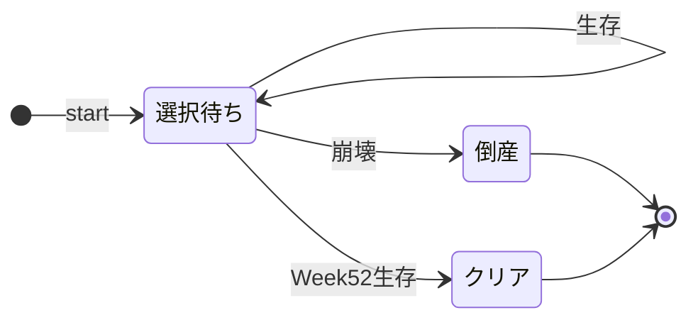

# 04 ゲームロジック設計書

> 版：1.0（2026-10-31） ／ 対象要件：`requirements_v1.12.md` ／ 関連：`01_architecture.md`、`05_data_design.md`
> 目的：ゲームのルールを、`src/core` の関数としてそのまま実装できる粒度で定義する。シミュレータ（7.5）と UI は、同じ関数を使う。

---

## 1. 設計方針

| # | 方針 |
|---|---|
| L1 | `core` の関数は**すべて純粋関数**にする。同じ入力からは必ず同じ出力を返し、引数を書き換えない。 |
| L2 | **乱数の状態も `RuntimeGameState` に持たせる**（`rngState`）。乱数ポートを外から渡す必要がなくなり、途中データから再開しても同じ乱数列が続く。 |
| L3 | 時刻は引数で受け取る（`start` の `now`）。`core` の中で `Date` を呼ばない。 |
| L4 | 状態の変化は `step(state, action) → { state, events }` の1か所だけで起こす。計測、保存、効果音などの副作用は、`app` 層が `events` を見て行う。 |
| L5 | 画面だけで使う一時的な状態（切り札の確認状態、ドラッグ中の傾き、アニメーション中など）は `core` に持たせず、`ui` 層で管理する。 |

---

## 2. ラン（1回のプレイ）の状態遷移



| 遷移 | きっかけ | 内容 |
|---|---|---|
| start | `start` | 山札を作り、Week 1 のカードを表示する |
| 生存 | `choose` ／ `useTrump` | `choose` は週を進めて次のカードを表示する。`useTrump` は同じカードのまま |
| 崩壊 | `choose` ／ `useTrump` | いずれかのパラメータが 0 または 100 に達した |
| Week52生存 | `choose` | Week 52 のカードを選んで、崩壊しなかった |

- `core` が持つ状態は「選択待ち」と「終了（`ending` が設定済み）」の2つだけ。終了した状態に `choose` や `useTrump` が来た場合は、何もせずに同じ状態を返す（イベントも出さない）。
- 画面の遷移（タイトル → 会社名 → スタイル選択 → プレイ → リザルト）は 02 画面設計書で定義する。

---

## 3. step 関数

```ts
type Action =
  | { type: 'start'; styleId: StyleId; companyName: string;
      isFirstPlay: boolean; seenCardIds: readonly string[];
      seed: number; now: string /* ISO 8601 */ }
  | { type: 'choose'; side: 'left' | 'right' }
  | { type: 'useTrump' };

function step(state: RuntimeGameState | null, action: Action, content: Content)
  : { state: RuntimeGameState; events: GameEvent[] };
```

- `content` は、カード、スタイル、結末、称号の定義をまとめたもの（05 データ設計書）。テストとシミュレータでは、差し替えたデータを渡せる。
- `seed` は `app` 層が作る（Web版では `crypto.getRandomValues` の値。シミュレータとテストでは固定値）。

### 3.1 イベント一覧

| イベント | いつ出るか | 主な中身 | `app` 層での使い道 |
|---|---|---|---|
| `runStarted` | `start` の処理後 | `styleId`、`isFirstPlay` | `game_start` の送信、SaveData の更新（`play_count` を +1 など） |
| `cardShown` | カードを表示する状態になったとき（開始時、各ターンの後） | `cardId`、`week`、`kind` | 既読への追加、効果音（めくり音） |
| `milestoneReached` | Week 13 / 26 / 39 / 52 のカードを表示したとき | `week` | `funnel_milestone` の送信 |
| `turnResolved` | `choose` を処理したとき | `week`、`side`、`applied`（倍率と丸めの後の効果値） | 画面の演出 |
| `injectionScheduled` | 連鎖カードを予約したとき | `cardId`、`targetWeek`、`originWeek` | デバッグ用（シミュレータの記録） |
| `injectionDiscarded` | 予約が Week 52 を超えて破棄されたとき | `cardId` | デバッグ用 |
| `trumpUsed` | `useTrump` を処理したとき | `week`、`applied` | `skill_used` の送信、効果音 |
| `gameOver` | 倒産したとき | `ending`、`week`、`sales`、`regret?`、`achievements` | `game_over` と `game_over_reason` の送信、SaveData の更新、途中データの削除 |
| `gameClear` | クリアしたとき | `sales`、`achievements` | `game_clear` の送信、SaveData の更新、途中データの削除 |

- 途中データの退避は、`ending` が未設定の状態を返すたびに `app` 層が行う（要件 7.2-3）。

---

## 4. ラン開始（start）

```
function start(action, content):
  rng ← seedRandom(action.seed)
  state ← {
    styleId, companyName, isFirstPlay, runStartedAt: action.now,
    currentWeek: 1,
    parameters: { cash: 50, client: 50, dev: 50, legal: 50 },
    cashGainedTotal: 0,
    minLegalSinceQ2: 100, maxCashSinceQ2: 0,
    usedTrumpCard: false,
    deck: buildDeck(content, styleId, isFirstPlay, seenCardIds, rng),
    usedCardIds: [], pendingInjections: [], shownChainCardIds: [],
    rngState: rng.state,
  }
  state ← showNextCard(state)        // 6.1 のドロー評価順で Week 1 のカードを決める
  events ← [runStarted, cardShown, (milestoneReached)]
```

---

## 5. 1ターンの処理（choose）

要件 3.1-6 の処理順（1〜10）をそのまま実装する。

```
function choose(state, side, content):
  card   ← content.cards[state.currentCardId]
  choice ← side == 'left' ? card.choice_left : card.choice_right
  style  ← content.styles[state.styleId]

  // 3〜4. 倍率と丸め
  applied ← applyPassives(choice.effects, style.passives)        // 7章

  // 5. 加算・クランプ・売上用の累計
  state.parameters ← clampAll(state.parameters + applied)        // 各 0〜100
  state.cashGainedTotal += max(applied.cash, 0)                  // クランプ前の値

  // 6. 極値の記録（Week 14 以降のターンのみ）
  if state.currentWeek >= 14:
    state.minLegalSinceQ2 ← min(state.minLegalSinceQ2, state.parameters.legal)
    state.maxCashSinceQ2  ← max(state.maxCashSinceQ2,  state.parameters.cash)

  // 連鎖カードを解決した場合は、敗因の判定用に記録する
  if card.kind == 'chain':
    state.lastChainResolved ← { resolvedWeek: state.currentWeek,
                                originWeek: state.currentOrigin.week,
                                regretText: state.currentOrigin.regretText,
                                effects: applied }

  // 7. 連鎖の予約
  if choice.inject_card_id:
    state ← scheduleInjection(state, injectionFromChoice(choice), content)   // 6.3

  // 通常カードなら使用済みに入れる（山札切れの再シャッフル用）
  if card.kind == 'normal': state.usedCardIds.push(card.id)

  // 8. 死亡判定
  ending ← judgeEnding(state.parameters)                          // 8.1
  if ending: return finish(state, ending)                         // 8.4

  // 9〜10. 週を進める。52 を超えたらクリア
  state.currentWeek += 1
  if state.currentWeek > 52: return finish(state, 'clear')
  return showNextCard(state)
```

- `state.currentOrigin` は、表示中のカードが連鎖カードのときだけ設定される（6.1）。
- 同じターンに「連鎖カードの解決」と「新しい連鎖の予約」が両方起こってもよい（連鎖カードの選択肢が、さらに別の連鎖を予約する場合）。

---

## 6. ドロー・山札・連鎖

### 6.1 次のカードを決める（showNextCard）

要件 3.1-6 のドロー評価順（v1.10）。上から評価し、最初に当てはまったものを表示する。

```
function showNextCard(state):
  w ← state.currentWeek
  state.currentOrigin ← undefined
  if state.isFirstPlay and w <= 2:
      id ← tutorialCardForWeek(w)                       // 1. 導入カード
  else if fixedCardForWeek(w) exists:
      id ← fixedCardForWeek(w)                          // 2. 季節固定（MVP は各週1枚）
  else if p ← state.pendingInjections.find(targetWeek == w):
      id ← p.cardId                                     // 3. 連鎖カード
      state.pendingInjections.remove(p)
      state.shownChainCardIds.push(id)
      state.currentOrigin ← { week: p.originWeek, regretText: p.regretText }
  else:
      if state.deck is empty:
          [state.deck, state.rngState] ← shuffle(state.usedCardIds, state.rngState)
          state.usedCardIds ← []
      id ← state.deck.shift()                           // 4. 通常の山札
  state.currentCardId ← id
```

- Phase 2 で季節固定カードを各週2〜3枚にしたときは、2. の中で `rng` を使って1枚を選ぶ。
- **山札も使用済みも空の場合**は、通常カード全体を再シャッフルする（防御的な処理。MVP の枚数では起こらない。1ランの通常ドローは最大48回、山札は Phase 1 で50枚、Phase 2 でスタイル別を加えて55枚）。

### 6.2 山札を作る（buildDeck）

要件 3.1-6「山札の構築手順」（v1.10）のとおり。

```
function buildDeck(content, styleId, isFirstPlay, seenCardIds, rng):
  pool ← content.cards.filter(c => c.kind == 'normal'
                               and (c.style_only == undefined or c.style_only == styleId))
  if isFirstPlay:
      front ← pool.filter(c => c.opening)
      back  ← pool.filter(c => !c.opening)
  else:
      seen  ← Set(seenCardIds)
      front ← pool.filter(c => !seen.has(c.id))         // 未読
      back  ← pool.filter(c =>  seen.has(c.id))         // 既読（opening は無視）
  return [...shuffle(front, rng), ...shuffle(back, rng)].map(c => c.id)
```

- シャッフルは Fisher–Yates 法で、`rng` を使う。

### 6.3 連鎖の予約（scheduleInjection）

予約の入力は、選択肢（`Choice`）と切り札（`StyleDef.trump.inject`）の両方から来る。項目名が違うので、共通の形 `InjectionParam` にそろえてから渡す（基本設計レビュー第2回の指摘1）。

```ts
interface InjectionParam {
  cardId: string;
  delay: [number, number];   // 省略時の [2, 6] は変換時に補う
  regretText: Text;          // { web, store? }（05 の 4.1）
}
// 選択肢から変換する
const injectionFromChoice = (c: Choice): InjectionParam => ({
  cardId: c.inject_card_id!,
  delay: c.inject_delay ?? [2, 6],
  regretText: { web: c.regret_text!, store: c.regret_text_store_safe },
});
// 切り札の inject は、最初から InjectionParam の形で定義する（05 の 4.1）
```

```
function scheduleInjection(state, inj: InjectionParam, content):
  id ← inj.cardId
  // 同じ連鎖カードは、1ランに1回まで（予約中または表示済みなら予約しない）
  if state.pendingInjections.some(cardId == id) or id in state.shownChainCardIds: return state
  [min, max] ← inj.delay
  [offset, state.rngState] ← randomInt(state.rngState, min, max)   // 両端を含む。乱数の状態を進めて保存する
  target ← state.currentWeek + offset
  // 衝突の解消：季節固定の週、導入カードの週、予約済みの週は避けて、1週ずつ後ろへずらす
  while target is fixedWeek or (state.isFirstPlay and target <= 2)
        or state.pendingInjections.some(targetWeek == target):
      target += 1
  if target > 52: emit injectionDiscarded; return state
  state.pendingInjections.push({ targetWeek: target, cardId: id,
                                 originWeek: state.currentWeek,
                                 regretText: inj.regretText })
  emit injectionScheduled
```

- **要件からの補足（2点）：**
  - 要件は「同じ連鎖カードが予約済みなら重複予約しない」としている。これを「**1ランに1回まで**（表示済みも含む）」に広げる。同じ「ツケ」が同じランで2回来ると、因果応報の印象が薄れるため。
  - 衝突を避ける対象に、**初回プレイの Week 1〜2（導入カードの週）**を加える。`inject_delay` の最小値が1のカードがあった場合に、導入カードと重なるのを防ぐため。

---

## 7. 効果値の計算

### 7.1 パッシブ倍率と丸め（applyPassives）

```ts
type Param = 'cash' | 'client' | 'dev' | 'legal';
interface Passive { param: Param; direction: 'gain' | 'loss'; factor: number }

function applyPassives(e: ChoiceEffect, passives: Passive[]): ChoiceEffect {
  const out = { ...e };
  for (const p of ['cash', 'client', 'dev', 'legal'] as const) {    // 定義順
    let v = e[p];
    for (const ps of passives.filter(x => x.param === p)) {         // 逐次乗算
      if ((ps.direction === 'gain' && v > 0) || (ps.direction === 'loss' && v < 0)) v *= ps.factor;
    }
    out[p] = signedRound(v);                                         // 丸めは最後に1回
  }
  return out;
}
const signedRound = (x: number) => Math.sign(x) * Math.round(Math.abs(x));
```

- 方向の判定は、**元の値**の符号で行う。倍率を掛けても符号は変わらない。

### 7.2 スタイル定義（暫定値。要件 3.3。最終値はシミュレータで決める）

> **2026-11-12 確定（Phase 1-A のシミュレータ）：** グレー派遣ブローカーのコンプラ減少は **×1.1**、切り札のコンプラは **−20** に変えた。他は表のとおり。経緯は `docs/balance/2026-11-12_phase1a.md`。

| スタイル | パッシブ | 切り札の効果（固定値・倍率なし） | 切り札の連鎖 |
|---|---|---|---|
| `taiikukai`（体育会系SES） | dev loss ×0.8、legal loss ×1.3 | dev +40、legal −20 | なし |
| `gray_broker`（グレー派遣ブローカー） | cash gain ×1.3、legal loss ×1.3 | cash +50、legal −25 | あり（要件 3.3、3.6-3）：監査の立ち入りカードを `[3, 8]` 週後に予約する |
| `tech_first`（技術至上主義SES） | dev loss ×0.7、cash gain ×0.8 | dev +30、client +20、cash −25 | なし |

### 7.3 切り札（useTrump）

```
function useTrump(state, content):
  if state.usedTrumpCard: return state（イベントなし）
  trump ← content.styles[state.styleId].trump
  applied ← trump.effects                                 // 倍率は掛けない
  state.parameters ← clampAll(state.parameters + applied)
  state.cashGainedTotal += max(applied.cash, 0)
  if state.currentWeek >= 14: 極値を記録（5章と同じ）
  state.usedTrumpCard ← true
  if trump.inject: state ← scheduleInjection(state, trump.inject, content)
  emit trumpUsed
  ending ← judgeEnding(state.parameters)                   // 直ちに判定（即死あり。要件 3.1-4）
  if ending: return finish(state, ending)
  return state                                             // 週は進めない。同じカードのまま
```

- 切り札の後も、表示中のカードはそのまま。プレイヤーは続けて2択を選ぶ。
- 切り札で死亡した場合の死亡週 N は、発動した週（`currentWeek`）とする（要件 3.1-1）。

### 7.4 予兆ドットの計算（ui 層から呼ぶ）

```ts
type Hint = 'none' | 'small' | 'large';
function previewChoice(state, side, content): Record<Param, Hint>   // applyPassives 後の値で判定
function previewTrump(state, content): Record<Param, Hint>          // 切り札の固定値で判定
// |v| == 0 → none、1〜9 → small、10 以上 → large（要件 7.1-1）
```

- 増減の向きは返さない（要件 7.1-1）。

---

## 8. 判定

### 8.1 死因（judgeEnding）

```
order ← ['cash', 'legal', 'dev', 'client']          // 要件 3.1-2 の優先順位
for p in order:
  if parameters[p] <= 0:   return `${p}_zero`
  if parameters[p] >= 100: return `${p}_max`
return null
```

- 同じパラメータでは、下限（0）を上限（100）より優先する。1つのパラメータが同時に 0 と 100 になることはないので、この順で評価すれば要件どおりになる。

### 8.2 敗因（judgeRegret）

```
function judgeRegret(state, ending):
  r ← state.lastChainResolved
  if not r or ending == 'clear': return undefined
  if state.currentWeek - r.resolvedWeek > 2: return undefined   // 連鎖カードの週を含めて3ターン以内
  [param, dir] ← split(ending)                                  // 例：'dev_zero' → ('dev', 'zero')
  moved ← dir == 'zero' ? r.effects[param] < 0 : r.effects[param] > 0
  return moved ? { week: r.originWeek, regretText: r.regretText } : undefined
```

### 8.3 売上と称号

```
survivedWeeks ← ending == 'clear' ? 52 : state.currentWeek - 1
sales ← survivedWeeks * 100 + state.cashGainedTotal * 50          // 単位：万円
```

| ID | 称号 | 条件 | 優先度 |
|---|---|---|---|
| `white_company` | ホワイト企業の鑑 | クリア かつ `minLegalSinceQ2 >= 65` | 1（最も高い） |
| `bicycle` | 自転車操業マスター | クリア かつ `maxCashSinceQ2 <= 40` | 2 |
| `emperor` | 人月搾取の帝王 | クリア かつ `sales >= 10000` | 3 |
| `phoenix` | 不死鳥社長 | クリア かつ `usedTrumpCard` | 4 |
| `audit_regular` | 監査局の常連 | `legal_zero` かつ 死亡週 `<= 9` | 5 |
| `speed_quit` | スピード退職 | `dev_zero` かつ 死亡週 `<= 9` | 6 |

- 閾値（65、40、10000、9）は `content` の定数として持ち、シミュレータで調整できるようにする。
- **2026-11-12 確定：** 『ホワイト企業の鑑』の閾値は **58**、売上の係数（cash 1 あたり）は **25**（`src/content/balance.ts`）。経緯は `docs/balance/2026-11-12_phase1a.md`。
- 返す称号の一覧は、優先度の高い順に並べる。シェア文とイベントには、先頭の1つを使う（要件 3.5）。

### 8.4 終了処理（finish）

```
function finish(state, ending):
  state.ending ← ending
  if ending != 'clear':
    state.endingDirection ← ending ends with '_zero' ? 'zero' : 'max'
    state.regret ← judgeRegret(state, ending)
  emit gameOver（または gameClear）{ ending, week: state.currentWeek, sales, regret, achievements }
```

---

## 9. 乱数（rng.ts）

- アルゴリズムは **mulberry32**（32ビットの状態を持つ軽量な疑似乱数）。状態は `RuntimeGameState.rngState` に数値で保存する。
- 提供する関数（**どれも乱数の状態を受け取り、結果と新しい状態の組を返す**）：`nextFloat(s) → [value, s']`、`randomInt(s, min, max) → [value, s']`（両端を含む）、`shuffle(array, s) → [newArray, s']`。
- **乱数を使う関数は、必ず `state.rngState` から乱数を引き、進めた状態を `state.rngState` に書き戻す。** `Math.random()` は `core` の中では使わない（ESLint の `no-restricted-properties` で禁止する）。これを守らないと、途中再開とシミュレータの再現性が壊れる（基本設計レビュー第2回の指摘3）。
- `buildDeck`（6.2）も、開始時の `rng` から引いた後の状態を `state.rngState` の初期値にする。
- 乱数を使う箇所：山札のシャッフル、再シャッフル、連鎖の予約週、（Phase 2）季節固定カードの選択。
- シードの作り方：Web版は `crypto.getRandomValues(new Uint32Array(1))[0]`。シミュレータはラン番号から作る（同じ実行条件なら同じ結果になる）。

---

## 10. 要件の型定義への追加項目

`RuntimeGameState`（要件 3.2）に、次の項目を追加する。05 データ設計書の型定義に反映する。

| 項目 | 型 | 理由 |
|---|---|---|
| `rngState` | `number` | 方針 L2。途中データから再開しても同じ乱数列にするため |
| `shownChainCardIds` | `string[]` | 6.3 の「同じ連鎖カードは1ランに1回まで」の判定 |

あわせて、敗因の文言を持つ項目（`PendingInjection.regretText`、`currentOrigin.regretText`、`lastChainResolved.regretText`、`regret.regretText`）の型を、`string` から `Text`（`{ web, store? }`）に変える。切り札の敗因も web / store の両方を持てるようにし、表示するときに `t()`（05 の 4.4）で選ぶため。

---

## 11. 境界条件の一覧（07 検証・テスト設計書でテストケースにする）

| # | 状況 | 期待する動き |
|---|---|---|
| E1 | Week 52 のカードで 0 または 100 に達した | クリアではなく倒産（死亡週は 52） |
| E2 | 2つのパラメータが同時に崩壊した | 優先順位（cash → legal → dev → client）で死因を決める |
| E3 | 切り札で 100 に達した | その週で倒産。週は進まない |
| E4 | 切り札を使った後、同じ週のカードを選んだ | 2択の効果が通常どおり適用される。切り札は再使用できない |
| E5 | 連鎖の予約週が Week 13 だった | Week 14 にずれる。Week 14 も予約済みなら Week 15 |
| E6 | Week 50 に `inject_delay [3, 6]` の連鎖を予約した | Week 53 以降になるので破棄する |
| E7 | 連鎖カードの選択肢が、さらに別の連鎖を予約した | 予約される。敗因の判定は、直近に解決した連鎖カードだけを対象にする |
| E8 | 連鎖カードで dev を下げ、2ターン後に cash で倒産した | 敗因は表示しない（死因のパラメータを動かしていない） |
| E9 | 連鎖カードで dev を下げ、3ターン後に dev で倒産した | 敗因は表示しない（3ターンを超えている） |
| E10 | 初回プレイ | Week 1〜2 は導入カード、Week 3 以降は opening のカードが先に出る |
| E11 | 2回目のプレイで、未読カードが5枚だけ残っていた | 最初の5枚が未読カード、その後に既読カード |
| E12 | 山札が空になった | 使用済みの通常カードを再シャッフルして続ける |
| E13 | 途中データから再開した | 中断前と同じカードが表示され、以後の乱数も中断しなかった場合と同じになる |
| E14 | 終了後に choose / useTrump が来た | 何も変わらず、イベントも出ない |
| E15 | 効果値が -2.5 になった | -3 に丸める（符号付き四捨五入） |
| E16 | 季節固定カード（例：Week 13）の表示中に切り札を使い、生存した | 週は 13 のまま、同じ季節固定カードの2択に戻る。選んだ後に Week 14 へ進む |
| E17 | グレー派遣ブローカーの切り札を使った | 監査の立ち入りカードが `[3, 8]` 週後に予約される。敗因の文言は切り札の `regretText` になる |
