# 10 静的モックアップ

> 版：1.0（2026-10-31） ／ 関連：`02_screen_design.md`、`03_ui_design_spec.md`
> 目的：画面設計書（02）と UIデザイン仕様（03）を、実際の見た目で確認する。

- **置き場所：** デザインキャンバス「限界SES社長 静的モックアップ」（claude.ai のアーティファクト：https://claude.ai/artifact/7ra4LSAKK8ddUbN9VkHtqm ）
- **フォント：** M PLUS 1 Code（Google Fonts から読み込み）。実装ではサブセット化したものをセルフホストする（01 の D6）。
- **画像：** 話者アイコンと結末の一枚絵は、点線の枠の仮素材にしている（要件 4.2 の素材が揃うまで）。

## 保存しているファイル（`docs/design/mockup/`）

| パス | 中身 | 開き方 |
|---|---|---|
| `mockup/index.html` | 全15画面を、キャンバスと同じ4段の並びで1ページに並べたもの | ブラウザで開く（フォントは Google Fonts から読み込むので、ネット接続が必要） |
| `mockup/screens/*.png` | 画面ごとの画像（等倍） | 画像ビューアで開く。下の一覧にも埋め込んでいる |
| `mockup/source/*.dc.html`、`canvas.json` | デザインキャンバスの元データ（2026-10-31 時点の最新版） | キャンバスの実行環境がないと表示できない。キャンバスを作り直すときや、実装時にマークアップを参照するときに使う |

- キャンバスで画面を直した場合は、この保存先も更新する（キャンバスの方が正）。

## 収録している画面（15枚）

| 行 | アートボード | 対応する画面（02） |
|---|---|---|
| 1. 基本の流れ（スマホ 390×844） | S01 タイトル ／ S02 会社名入力（エラー表示）／ S03 経営スタイル選択 ／ S04 プレイ（通常）／ S04 ドラッグ中（予兆ドット）／ S04 切り札の確認中 | S01〜S04 |
| 2. プレイの状態・リザルト・図鑑（スマホ） | S04 連鎖カード（危険域のゲージ）／ S04 初回の導入カード ／ S05 倒産 ／ S05 クリア ／ M01 図鑑 ／ P01 結末紹介ページ | S04、S05、M01、P01 |
| 3. PC（1280 幅） | S04 プレイ（キー操作のヒントつき）／ S05 リザルト（2列） | S04、S05 |
| 4. UIデザイン仕様の見本 | 色・文字・ゲージ・ボタン・バッジ | 03 |

## レビューで見てほしい点
1. 配色：暗さ、緑・アンバー・赤の使い分けが、意図（正常・切り札と因果・危険）どおりに伝わるか。
2. プレイ画面：カードの本文が読みやすいか。ゲージと予兆ドットが見分けられるか。決断ボタンと切り札ボタンの区別。
3. リザルト：倒産報告書がシェアしたくなる見た目か。「もう1期挑む」がいちばん目立っているか。
4. スマホで指が届く位置に、操作が集まっているか（決断ボタンと切り札は画面の下部）。

## 画面の一覧（画像）

| | | |
|---|---|---|
| S01 タイトル 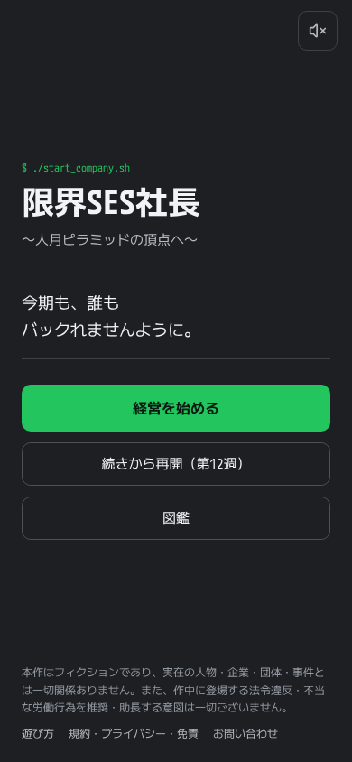 | S02 会社名入力 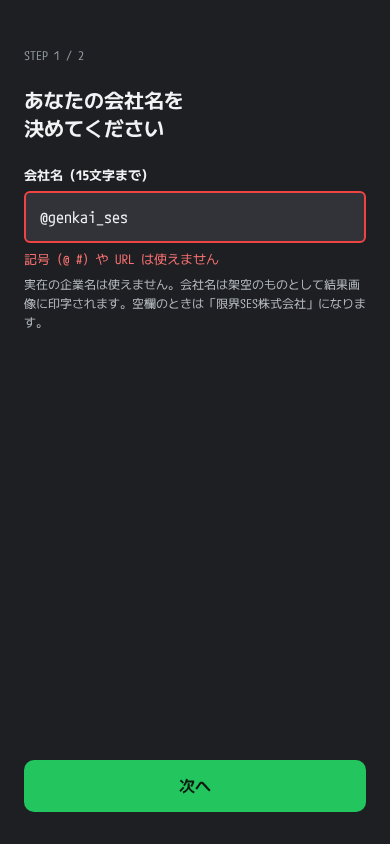 | S03 経営スタイル選択 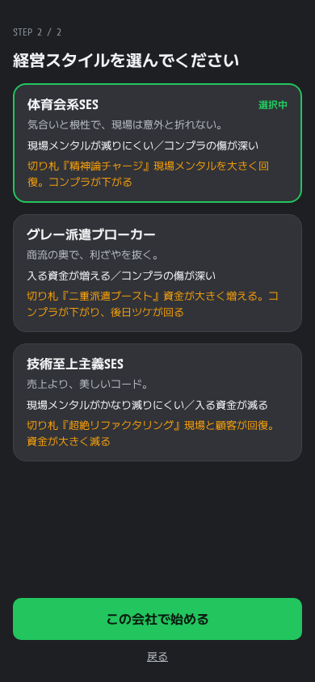 |
| S04 プレイ（通常） 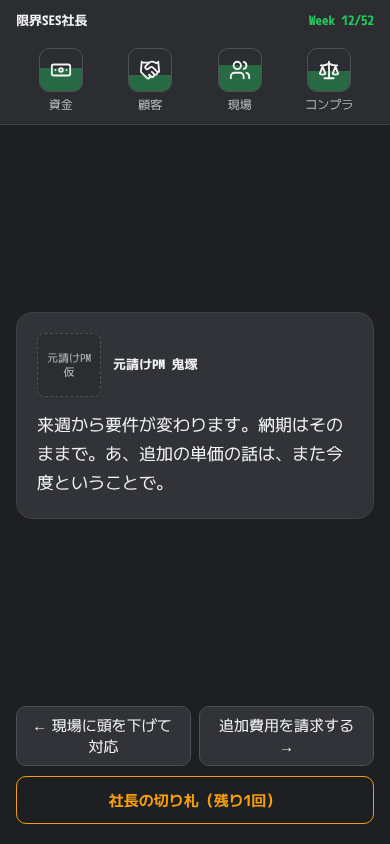 | S04 ドラッグ中 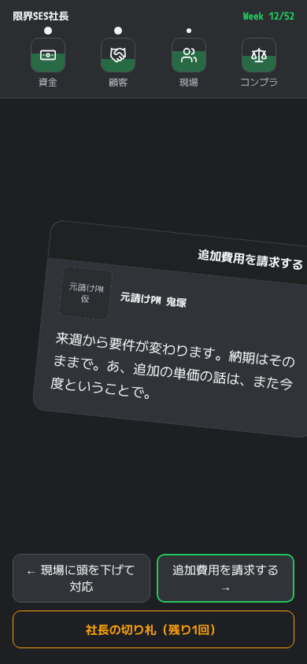 | S04 切り札の確認中 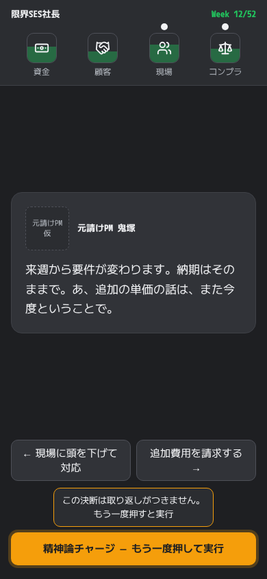 |
| S04 連鎖カード 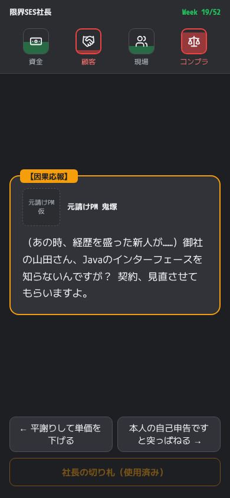 | S04 導入カード 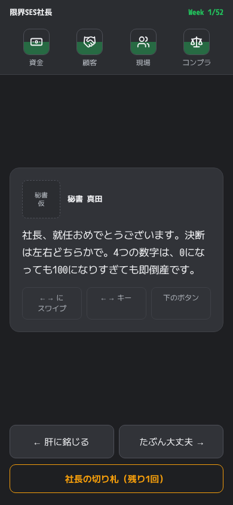 | M01 図鑑 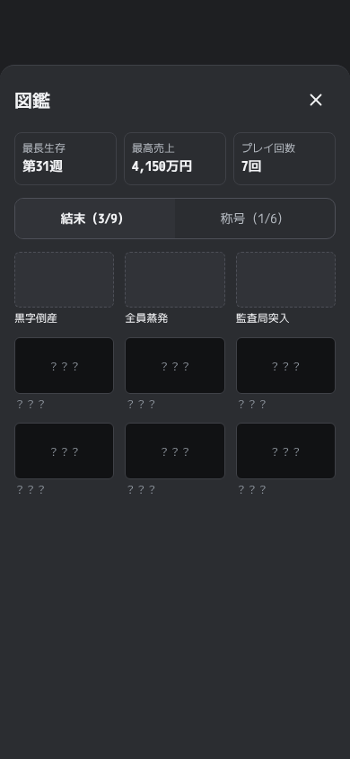 |
| S05 倒産 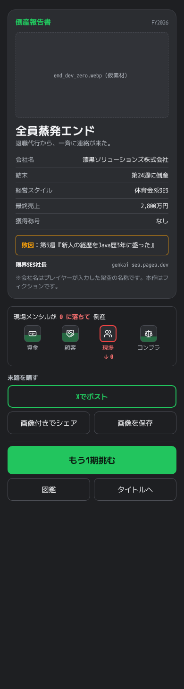 | S05 クリア 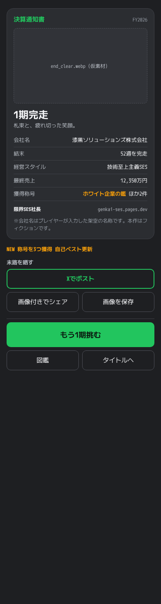 | P01 結末紹介ページ 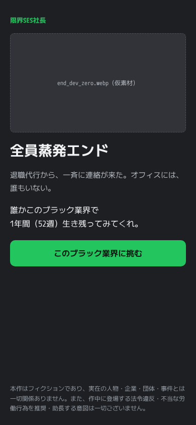 |

**PC**

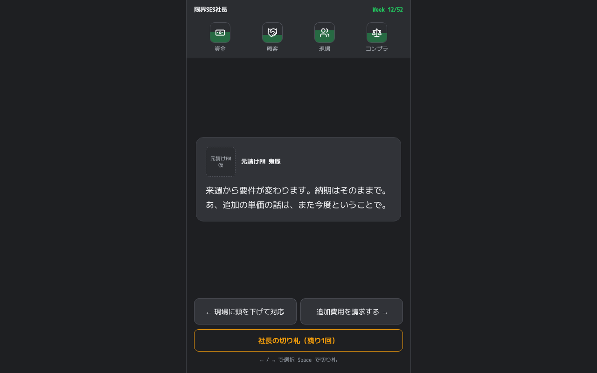

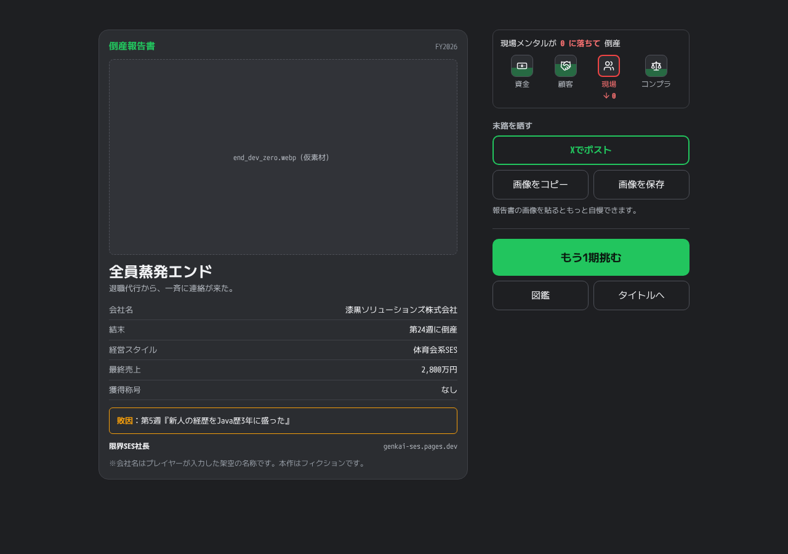

**配色・文字・部品**

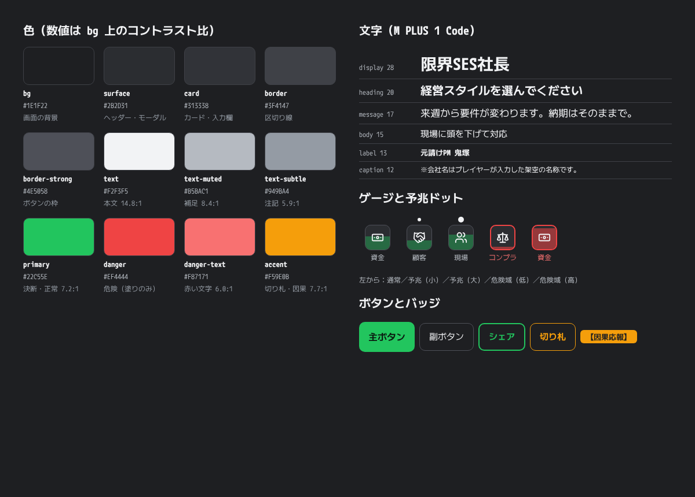
