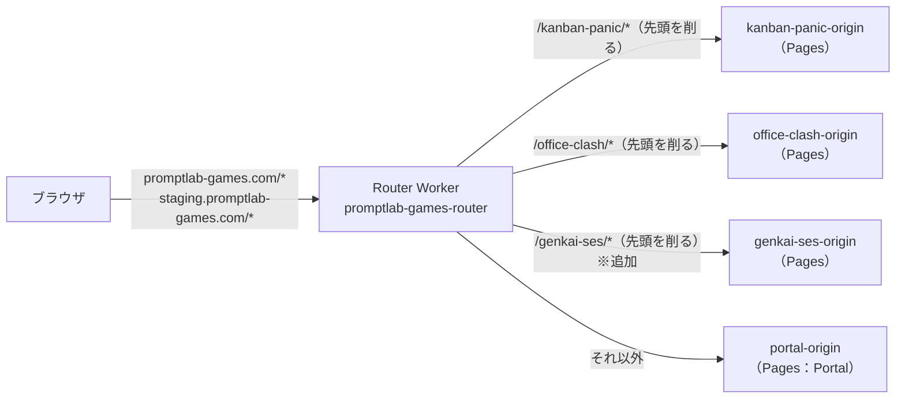

# 11 公開統合設計書（PromptLab Games）

> 版：1.0（2026-11-01） ／ 対象要件：`requirements_v1.13.md`（8章） ／ 関連：`01`、`06`、`07`、`08`、`09`（検証4）
> 目的：ブランド「PromptLab Games」の共通ドメイン配下に公開するための設計をまとめる。**01・02・06・08 の記述と食い違う場合は、本書を正とする**（公開先の変更は、これらの資料の作成後に決まったため）。

---

## 1. 既存の公開アーキテクチャ（2026-11-01 に各リポジトリで確認）

| 確認したこと | 内容 | 出典 |
|---|---|---|
| Router の転送 | ゲームのパスは先頭を削ってオリジンへ。それ以外は Portal へ。ゲームのパスちょうど（末尾スラッシュなし）は Router が 308 で末尾スラッシュ付きへ | `promptlab-games-router/src/router.ts`、README |
| Router のレスポンス | 書き換えない。エラーでも別のオリジンに切り替えない | 同 README の 3章 |
| Router の設定と検証 | 設定は `src/config.ts`、テストは `tests/router.test.ts`（Vitest）。`npm run verify` | 同リポジトリ |
| ステージング | `staging.promptlab-games.com` も同じ Worker（`wrangler.jsonc` の routes）。本番と同じオリジンへ転送 | `wrangler.jsonc` |
| Portal のゲーム一覧 | `src/portal/gameRegistry.ts` の配列（`slug`、`title`、`path`、`status`、`description`）と `public/sitemap.xml` | `promptlab-games` |
| 規約など | Portal に `/privacy`、`/terms`、`/contact`（support@digi-garden.com）がある。プライバシーポリシーは「アクセス解析は導入していない」と記載 | `src/portal/PortalShell.ts` |
| 既存ゲームの設定 | Vite の `base: '/kanban-panic/'`。`_redirects`・`404.html` なし（Pages 既定の SPA フォールバック）。本番ブランチ `develop`。CI は Node 24。公開パス付きの本番ビルドに対する E2E（`test:e2e:preview`、`base_path` テスト） | `kanban-panic` の `vite.config.ts`、`docs/web-release-runbook.md`、`.github/workflows/ci.yml` |
| AdSense | Portal に `ads.txt` と AdSense の所有確認がある（審査中） | `promptlab-games/public/ads.txt` |

---

## 2. 本作の設定

| 項目 | 値 |
|---|---|
| game-slug | `genkai-ses` |
| 公開 URL | `https://promptlab-games.com/genkai-ses/` |
| オリジン | `https://genkai-ses-origin.promptlab-games.com`（Pages のカスタムドメイン） |
| Vite の `base` | 本番（`develop`）：`/genkai-ses/`。それ以外のブランチのプレビュー：`/` |
| `VITE_SITE_ORIGIN`（01 の 7.2） | `https://promptlab-games.com` |
| `VITE_PUBLIC_BASE` | `/genkai-ses`（OGP・canonical・シェア URL の組み立てに使う） |
| 本番ブランチ | `develop`（01・08 の `main` を置き換える） |
| Node.js | 24 系（01 の 3章の 22 を置き換える） |

### 2.1 URL の一覧

| 用途 | 公開 URL | オリジン上のパス | `dist` のファイル |
|---|---|---|---|
| ゲーム本体 | `/genkai-ses/` | `/` | `index.html` |
| JS・CSS・画像・フォント | `/genkai-ses/assets/…` | `/assets/…` | `assets/…` |
| 結末ページ | `/genkai-ses/results/dev-zero` | `/results/dev-zero` | `results/dev-zero.html` |
| OGP 画像 | `/genkai-ses/ogp/end_dev_zero.png` | `/ogp/…` | `ogp/…` |
| シェア URL | `https://promptlab-games.com/genkai-ses/results/dev-zero?utm_source=x&utm_medium=share` | | |

- **末尾スラッシュなしで統一する**（09 検証4）。06 の 3.1・5.1 の `/results/{slug}/` は、`/results/{slug}` と `results/{slug}.html` に読み替える。
- 結果画像に印字する URL は `promptlab-games.com/genkai-ses`（06 の 3.2 と 02 の S05）。

### 2.2 プレビュー環境
- `develop` 以外のブランチ（`preview/〇〇`。08 の 6.1）のビルドでは、`base` を `/` にする。`vite.config.ts` で、Pages が設定する環境変数 `CF_PAGES_BRANCH` を見て切り替える。
- プレビュー環境では、GA4 と Cloudflare Web Analytics を読み込まない（01 の 7.2 と同じ）。

---

## 3. 計測と規約（06・08 の変更点）

| 項目 | 変更 |
|---|---|
| プライバシーポリシー | ゲーム内に独自のポリシーを持たず、ブランドの `/privacy` にリンクする。公開前に Portal リポジトリで、本作の計測（GA4、Cloudflare Web Analytics）と外部送信の一覧（06 の 6章）を追記する |
| 利用規約・お問い合わせ | ブランドの `/terms`、`/contact` にリンクする（08 の 7章の独自の文面と Google フォームは作らない） |
| ゲーム内のモーダル（02 の M03・M04） | M03 は「本作固有の免責事項（フィクション、会社名は架空）」と、ブランドのページへのリンクだけにする。M04 はブランドの `/contact` へのリンクにする |
| 計測タグ | ゲームの `index.html` と結末ページにだけ入れる（Portal と他タイトルには入れない） |
| Cloudflare Web Analytics のサイト | `promptlab-games.com` 全体ではなく、本作のページだけで数える。ダッシュボードでは URL のパス（`/genkai-ses/`）で絞り込む |
| 同意の保存 | `genkai_ses_consent_v1`（本作だけの設定。ブランド共通の同意の仕組みは現在ない） |

---

## 4. Router への追加（`promptlab-games-router`）

### 4.1 変更内容
- `src/config.ts` に `genkaiSesOrigin: "https://genkai-ses-origin.promptlab-games.com"` と `genkaiSesPrefix: "/genkai-ses"` を追加する。
- `src/router.ts` に、既存のゲームと同じ2つのルール（パスちょうどなら 308、`/genkai-ses/` で始まるなら先頭を削って転送）を、**Portal へのフォールバックより前**に追加する。既存のルールの順番と動きは変えない。
- README の「Known Origins」と「Routing Rules」に追記する。

### 4.2 追加するテスト（`tests/router.test.ts`）

| # | テスト |
|---|---|
| 1 | `/genkai-ses` → 308、`Location` は `/genkai-ses/`。転送しない |
| 2 | `/genkai-ses?x=1` → 308、クエリを保持する |
| 3 | `/genkai-ses/` → オリジンの `/` |
| 4 | `/genkai-ses/assets/index-abc.js` → オリジンの `/assets/index-abc.js` |
| 5 | `/genkai-ses/results/dev-zero?utm_source=x` → オリジンの `/results/dev-zero?utm_source=x` |
| 6 | `/genkai-ses-foo/` と `/genkai-sesx` → Portal（似た名前を誤って転送しない） |
| 7 | オリジンの 404 を、そのまま返す（Portal に切り替えない） |
| 8 | 既存のテスト（Portal、KANBAN PANIC、OFFICE CLASH）がすべて通る |

---

## 5. Portal への追加（`promptlab-games`）

| ファイル | 変更 |
|---|---|
| `src/portal/gameRegistry.ts` | `{ slug: 'genkai-ses', title: '限界SES社長 〜人月ピラミッドの頂点へ〜', path: '/genkai-ses/', status: 'coming-soon', description: '今期も、誰もバックれませんように。' }` を追加する。ステージングで確認できたら `live` にする |
| `public/sitemap.xml` | `https://promptlab-games.com/genkai-ses/` を追加する（結末ページは載せない。ゲームのページとして重複が多いため） |
| `src/portal/PortalShell.ts`（プライバシーポリシー） | 3章のとおり追記する |
| テスト | 既存の `gameRegistry.test.ts`、`sitemap.test.ts`、E2E を更新して通す |

---

## 6. ゲーム側の検証（07 への追加）

### 6.1 公開パスの E2E（`tests/e2e/base_path.test.ts`）
- 本番と同じ設定でビルドした `dist` を、**`/genkai-ses` を削ってから `dist` を配信する小さなプロキシ**越しに開く。テスト用のプロキシは、Router の転送ルールを再現し、`wrangler pages dev dist` の前に置く。こうすると、Pages の SPA フォールバックとリダイレクトの動きも、本番と同じ形で確かめられる。
- 確認すること：
  - `/genkai-ses/` が起動し、コンソールにエラーがない
  - ページが読み込むすべてのリソース（JS・CSS・画像・フォント）が 200 で、HTML が返っていない（存在しない画像も 200 の HTML になるため、`content-type` で確かめる。09 検証1）
  - `/genkai-ses/results/dev-zero` が 200 で、OGP のタグがある。ボタンで `/genkai-ses/` に移る
  - `/genkai-ses/unknown` で再読み込みしても、タイトル画面に戻る
  - **ページ内のどのリンクも、末尾スラッシュ付きのパス（リダイレクトの原因）になっていない**
- このテストは、07 の E2E の Phase 1 の範囲（T1・T3・T5・T8）に加える。

### 6.2 公開後の確認
- 要件 8.6 の完了条件を、ステージング（`staging.promptlab-games.com`）と本番で、同じチェックリストで確かめる。結果はリリース手順書（`docs/release-runbook.md`）に記録する。

---

## 7. 他の設計書との対応（読み替え）

| 資料 | 読み替え |
|---|---|
| 01 の 2章・7.2 | ホスティングは「Router Worker → Pages」。本番ブランチは `develop`。Node 24。環境変数に `VITE_PUBLIC_BASE` を追加 |
| 02 の M03・M04、P01 | 3章、2.1 |
| 06 の 2.3、3.1、5.1〜5.3 | 結末ページの URL とファイル（2.1）。計測タグの範囲（3章） |
| 07 の 4章 | 6章を追加 |
| 08 の 6.1、7章 | 本番ブランチは `develop`。法的表記はブランドのページを使う（3章） |
| 09 の 検証1 | 「末尾にスラッシュを付ける」は、検証4で取り消し |
