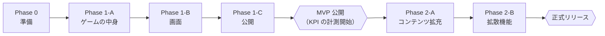

# 実装フェーズ計画書

> 版：1.0（2026-11-01） ／ 対象：`requirements_v1.13.md`、`docs/design/00〜11`
> 目的：実装を段階に分け、各段階の作業・担当・完了条件・工数を決める。**実装は AI（Claude）が担当し、オーナーは判断・確認と、AI にできない作業を担当する**前提で見積もる。

---

## 1. 前提：誰が何をするか

### 1.1 AI（Claude）が担当すること
- コード・テスト・ビルドスクリプト・CI の作成と修正（ゲーム本体、Router と Portal への追加分）
- シミュレータの実行と、カードの数値の調整
- カード62枚（Phase 2 で100枚以上）の文面の下書き（要件 3.6 の執筆ガイドラインに従う）
- GitHub へのプッシュとプルリクエストの作成（`digi-garden` の各リポジトリ。書き込み権限は確認済み）
- 仮素材（ファイル名入りの画像）、OGP 画像の合成、README・リリース手順書・開発記事の下書き
- 公開後の確認のうち、ネット越しにできるもの（各 URL の取得、ヘッダーの確認）

### 1.2 AI にできないこと（オーナーの作業になるもの）

| 作業 | 理由 |
|---|---|
| GitHub リポジトリ `digi-garden/genkai-ses` の作成 | AI は既存のリポジトリにしか書き込めない |
| Cloudflare の設定（Pages プロジェクト、カスタムドメイン、環境変数、ブランチの制御、ビルドの対象パス、Web Analytics） | AI の作業環境からは Cloudflare の管理画面・API に接続できない |
| Router のデプロイ（`wrangler deploy`） | 同上（Cloudflare の認証情報が必要） |
| GA4 のプロパティ作成、DebugView での確認 | Google アカウントが必要 |
| 画像素材18枚の生成と権利確認（要件 4.2） | AI は画像を生成できない |
| iPhone・Android の実機での確認（画像生成、共有シート、操作感） | 実機が必要 |
| X への試験投稿（OGP カードの表示確認） | X アカウントが必要 |
| プルリクエストのマージ（本番への反映の判断） | 公開の責任はオーナーにある |
| カードの表現の最終判断、人によるテストプレイ（面白さ・難しさの体感） | 判断はオーナーの領分 |

---

## 2. フェーズの全体像

| フェーズ | 週（目安） | 主な成果物 | 完了の判断 |
|---|---|---|---|
| Phase 0 準備 | Week 1 前半 | リポジトリ、ひな形、CI、Cloudflare の設定 | オーナー |
| Phase 1-A ゲームの中身 | Week 1〜2 | `core`、シミュレータ、カード62枚 | オーナー（カードの表現） |
| Phase 1-B 画面 | Week 2〜3 | 全画面、保存、計測、結末ページ | オーナー（実機での操作感） |
| Phase 1-C 公開 | Week 4 | Router・Portal への追加、ステージングと本番での確認 | オーナー（公開の判断） |
| Phase 2-A コンテンツ拡充 | Week 5〜6 | スタイル別15枚、100枚以上、図鑑と称号の仕上げ | オーナー |
| Phase 2-B 拡散機能 | Week 7〜8 | 結果画像とシェア、解説記事、E2E の拡充 | オーナー（正式リリースの判断） |

- 要件 6章のロードマップ（8週間）の区切りに合わせている。AI の作業はオーナーの確認待ちで止まることが多い。週の区切りは、**オーナーが週4〜8時間で確認できる量**で決めている。
- 図鑑と称号は、要件のロードマップでは Week 6 だが、判定ロジックは Phase 1-A で `core` に入れる（シミュレータの合格基準 A6・A7 に必要なため）。Phase 2-A では、図鑑の画面と演出を仕上げる。
- **計測（GA4）は Phase 1 に入れる。** KPI（要件 1.1）は MVP の公開から2〜4週間で判定するので、公開の時点で計測が動いている必要があるため。

---

## 3. フェーズごとの作業

凡例：**AI** ＝ Claude、**オーナー** ＝ あなた。オーナーの時間は見積もり（h＝時間）。

### Phase 0：準備（Week 1 前半）

| # | 作業 | 担当 | オーナーの時間 |
|---|---|---|---|
| 0-1 | GitHub に `digi-garden/genkai-ses` を作る（空のリポジトリ、既定ブランチ `develop`） | オーナー | 0.2h |
| 0-2 | ひな形（Vite・React・TypeScript・Tailwind・ESLint・dependency-cruiser・Vitest・Playwright）、フォルダ構成（01 の 5章）、CI（GitHub Actions）、`docs/` の移設 | AI | ― |
| 0-3 | 公開パス（`/genkai-ses/`）でのビルドと、先頭を削るプロキシ越しの E2E の土台（11 の 6.1） | AI | ― |
| 0-4 | Cloudflare Pages のプロジェクト作成。本番ブランチ `develop`、ビルドの設定、ブランチの制御（`preview/*` だけ）、ビルドの対象パス、Node 24。手順は AI が書く | オーナー | 1.0h |
| 0-5 | GA4 のプロパティ作成、Cloudflare Web Analytics のサイト登録。測定 ID とトークンを環境変数に設定 | オーナー | 0.5h |
| 0-6 | 確認：CI が通り、プレビューにひな形が表示される | オーナー | 0.3h |
| | **小計** | | **2.0h** |

### Phase 1-A：ゲームの中身（Week 1〜2）

| # | 作業 | 担当 | オーナーの時間 |
|---|---|---|---|
| 1A-1 | `core`（04 のすべて：step、ドロー、山札、連鎖、切り札、判定、乱数）と単体テスト（E1〜E17 を含む） | AI | ― |
| 1A-2 | カード JSON のスキーマと検証（05 の 3.4、V1〜V13、NG 語の検出） | AI | ― |
| 1A-3 | シミュレータ（07 の 3章。Bot 5種、合格基準 A1〜A7） | AI | ― |
| 1A-4 | **カード62枚の下書き**（導入2、季節4、連鎖6、共通50）。執筆ガイドライン（3.6）、表現ルール（3.6-8）に従う | AI | ― |
| 1A-5 | **カードの表現の確認**：62枚を読み、風刺の向き・表現・あるあるの解像度を確かめて直しを指示する | オーナー | 2.5h |
| 1A-6 | 直しの反映と、シミュレータの合格基準を満たすまでの数値調整 | AI | ― |
| 1A-7 | 確認：シミュレータの結果（生存週の分布、死因の比率）を見て、狙いの難しさになっているかを判断 | オーナー | 0.5h |
| | **小計** | | **3.0h** |

### Phase 1-B：画面（Week 2〜3）

| # | 作業 | 担当 | オーナーの時間 |
|---|---|---|---|
| 1B-1 | 画面（02・03 の S01〜S05、M01〜M04）。スワイプ・キー・ボタン操作、予兆ドット、切り札の2段階操作、連鎖のバッジ、導入カード | AI | ― |
| 1B-2 | 保存（SaveData、途中データ、移行、メモリへのフォールバック） | AI | ― |
| 1B-3 | フォントのサブセット化、画像の読み込み順（素材18枚は確定済み。仮素材は不要） | AI | ― |
| 1B-4 | 計測（GA4 のイベント、同意バナー、Cloudflare Web Analytics のタグ、`heartbeat_10s`） | AI | ― |
| 1B-5 | 結末ページ（`results/{slug}.html`）と OGP 画像の生成スクリプト、`_headers`（CSP） | AI | ― |
| 1B-6 | E2E（Phase 1 の範囲：T1・T3・T5・T8 と公開パスのテスト） | AI | ― |
| 1B-7 | ~~画像素材の生成~~ **完了（2026-11-11 に前倒しで実施）。** 18枚（話者アイコン9、結末の一枚絵9）を ChatGPT で生成し、権利確認と記録も済み（`docs/asset_log.md`） | オーナー | 0h（実績は Phase 0 の前に計上） |
| 1B-8 | **人によるテストプレイ**（PC とスマホで10回程度）。面白さ・難しさ・操作感の確認 | オーナー | 2.0h |
| 1B-9 | **実機での確認**（iPhone の Safari、Android の Chrome）。07 の 6章のうち、操作・表示・保存 | オーナー | 1.0h |
| 1B-10 | テストプレイと実機確認の指摘の反映 | AI | ― |
| | **小計** | | **6.0h** |

### Phase 1-C：公開（Week 4）

| # | 作業 | 担当 | オーナーの時間 |
|---|---|---|---|
| 1C-1 | Router に `genkai-ses` を追加するプルリクエスト（設定、テスト8本、README）。既存のテストがすべて通ることを確認 | AI | ― |
| 1C-2 | Portal のプルリクエスト（ゲーム一覧に `coming-soon` で追加、プライバシーポリシーへの計測の追記、テストの更新） | AI | ― |
| 1C-3 | プルリクエストの確認とマージ（ゲーム、Router、Portal） | オーナー | 1.0h |
| 1C-4 | オリジンのカスタムドメイン（`genkai-ses-origin.promptlab-games.com`）の設定、Router のデプロイ | オーナー | 0.5h |
| 1C-5 | **ステージングでの確認**（`staging.promptlab-games.com/genkai-ses/`）。要件 8.6 のチェックリスト。AI が URL の取得とヘッダーを確認し、オーナーはブラウザで遊んで確かめる | オーナー＋AI | 1.0h |
| 1C-6 | Portal の掲載を `live` にする（プルリクエストは AI、マージはオーナー） | オーナー | 0.2h |
| 1C-7 | 本番での確認（8.6 のチェックリスト）、GA4 の DebugView でイベントが届くことの確認 | オーナー＋AI | 0.8h |
| 1C-8 | リリース手順書（`docs/release-runbook.md`）と README に、手順と確認結果を記録 | AI | ― |
| | **小計** | | **3.5h** |

### Phase 2-A：コンテンツ拡充（Week 5〜6）

| # | 作業 | 担当 | オーナーの時間 |
|---|---|---|---|
| 2A-1 | スタイル別カード15枚と、共通カードの追加（計100枚以上）の下書き。季節固定カードの候補を各週2〜3枚に | AI | ― |
| 2A-2 | 追加カードの表現の確認 | オーナー | 2.0h |
| 2A-3 | シミュレータでの再調整（A5 のスタイル別クリア率、A6 の称号） | AI | ― |
| 2A-4 | 図鑑の画面と、称号・新記録の演出の仕上げ | AI | ― |
| 2A-5 | MVP の KPI の途中経過を見て、次の改善の優先順位を決める（AI が GA4 のデータの読み方を用意する） | オーナー | 1.0h |
| 2A-6 | テストプレイ（追加分） | オーナー | 1.0h |
| | **小計** | | **4.0h** |

### Phase 2-B：拡散機能と正式リリース（Week 7〜8）

| # | 作業 | 担当 | オーナーの時間 |
|---|---|---|---|
| 2B-1 | 結果画像の生成（先に作っておく方式）、シェア文の組み立て（5段階の調整）、Web Share・コピー・保存 | AI | ― |
| 2B-2 | E2E の残り（T2・T4・T6・T7・T9）、CI に WebKit を追加 | AI | ― |
| 2B-3 | **実機での確認**（iPhone の Safari で結果画像が正しく作れるか、共有シートが開くか。ダメなら Canvas 2D 版へ切り替え） | オーナー | 1.0h |
| 2B-4 | X への試験投稿（非公開アカウントで OGP カードの表示を確認） | オーナー | 0.5h |
| 2B-5 | 解説記事（同じドメインに載せる、設計・開発・テストの記事）と、Qiita / Zenn 向け記事の下書き | AI | ― |
| 2B-6 | 記事の確認と手直し（自分の言葉にする部分） | オーナー | 3.0h |
| 2B-7 | 正式リリースの確認（07 の 6章のチェックリスト全体）、公開の判断、X での告知 | オーナー | 2.0h |
| | **小計** | | **6.5h** |

---

## 4. 工数の合計（オーナー）

| フェーズ | 時間 |
|---|---|
| Phase 0 準備 | 2.0h |
| Phase 1-A ゲームの中身 | 3.0h |
| Phase 1-B 画面 | 6.0h |
| Phase 1-C 公開 | 3.5h |
| Phase 2-A コンテンツ拡充 | 4.0h |
| Phase 2-B 拡散機能 | 6.5h |
| **合計** | **25.0h** |
| 予備（手戻り・想定外。合計の30%） | 7.5h |
| **予備を含めた合計** | **約33h** |

- 要件の「週4〜8時間 × 8週間（40〜60時間）」に対して、**下限の40時間にも収まる**。基本設計レビュー第4回の試算（58〜82時間）は、オーナーがコードを書く前提だったので、この前提では当てはまらない。
- **時間を最も使うのは、画像素材の生成（3h）、カードの表現の確認（計4.5h）、記事の手直し（3h）。** どれも作品の質に直結する作業で、AI には任せられない。
- 週ごとに見ると、Week 3（画像素材とテストプレイ）が約6時間で最も重い。画像素材は Week 2 から前倒しで始めると平らになる。

### 4.1 AI 側の作業量と、それが前提にしていること
- AI の作業は、各フェーズで数回の作業セッション（1回のやりとりで数十分〜数時間の作業）にまとめて行う。週あたりの作業量の上限は、AI ではなく**オーナーの確認の速さ**で決まる。
- AI の作業時間は、オーナーの工数には数えない。ただし、AI に依頼して結果を確認するやりとりの時間は、各フェーズの「確認」に含めている。
- AI のコードの品質は、CI（lint、型、単体テスト、カード検証、シミュレータ、E2E）で機械的に確かめる。オーナーがコードを1行ずつ読む前提にはしていない（読む場合は、そのぶん工数が増える）。

---

## 5. 遅れたときの削減ライン

基本設計の4回のレビューすべてで「削減ラインを、いつ・何を見て発動するかを決めること」と指摘された。オーナーの時間が足りなくなったときに、次の順で削る。

| 順 | 削るもの | 発動の判断（見るもの） | 削った場合の影響 |
|---|---|---|---|
| 1 | 季節固定カードの候補を各週2〜3枚に増やす作業（2A-1 の一部） | Week 5 の終わりに、2A-2（表現の確認）が終わっていない | 季節イベントが毎回同じになる（MVP と同じ） |
| 2 | 100枚以上への拡充（スタイル別15枚は残し、共通カードの追加を止める） | Week 6 の終わりに、追加カードの確認が半分に届いていない | 計77枚で正式リリース。未読カードの優先ドローで、リプレイ性は一定程度保てる |
| 3 | Qiita / Zenn 向け記事（同じドメインの解説記事は残す） | Week 7 の終わりに、2B-6 の時間が取れない | 外部からの初期流入が減る。リリース後に書いてもよい |
| 4 | E2E の Phase 2 分（T2・T4・T6・T7・T9）と WebKit | Week 7 の終わりに、2B-1・2B-3 が終わっていない | 自動テストの範囲が減る。手動確認で代わりにする |

- **削らないもの：** カードの表現の確認（3.6 と AdSense の観点で必須）、実機での画像生成の確認、公開の完了条件（要件 8.6）、計測。
- 画像素材が間に合わない場合は、仮素材のまま MVP を公開して、Phase 2 で差し替える（素材は同じファイル名で上書きするだけで差し替わる。08 の 2.2）。この場合、OGP 画像も仮のものになるので、拡散を本格的に狙う告知は差し替えの後にする。

---

## 6. 進め方のルール

- **フェーズの区切りで、毎回オーナーが確認する**（これまでの進め方と同じ）。AI は、各フェーズの終わりに「できたもの、確認してほしいこと、判断が必要なこと」をまとめて報告する。
- 作業ブランチは `feature/〇〇`。プレビューで確認したいときは `preview/〇〇`（08 の 6.1）。`develop` へのマージはオーナーが行う。
- 他のリポジトリ（Router、Portal）への変更は、それぞれのリポジトリの規約とテストに従い、プルリクエストで出す。既存のタイトルに影響する変更はしない。
- 設計と食い違う実装が必要になったときは、実装を先に進めず、設計書の更新案と一緒に報告する。
